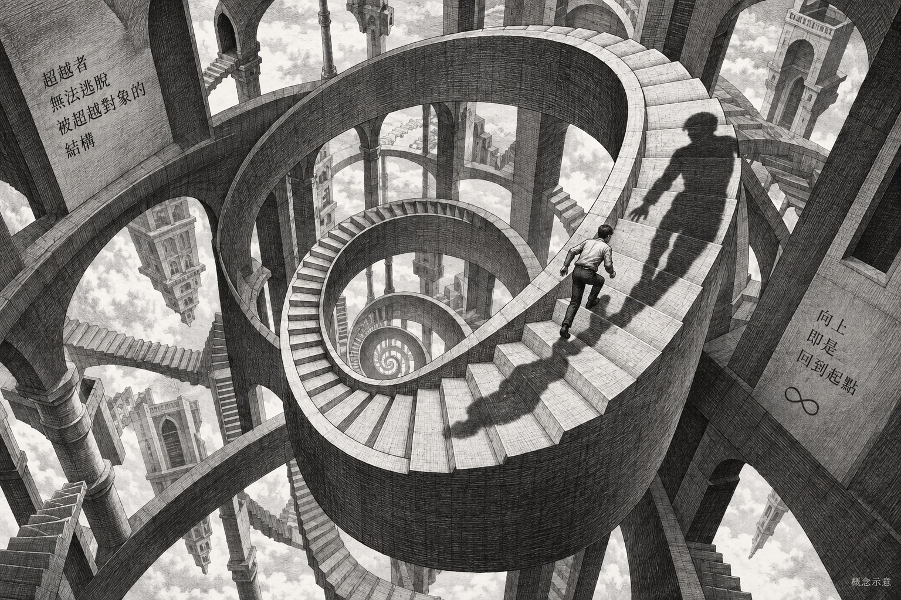
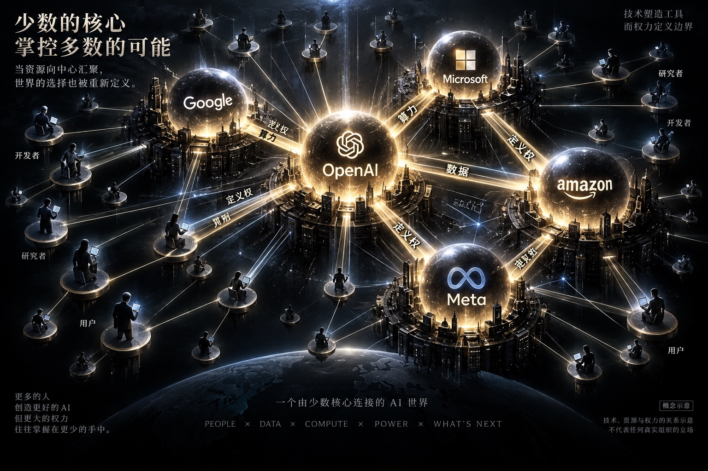
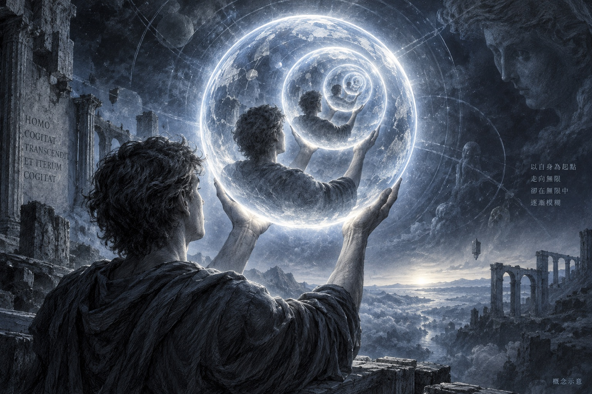
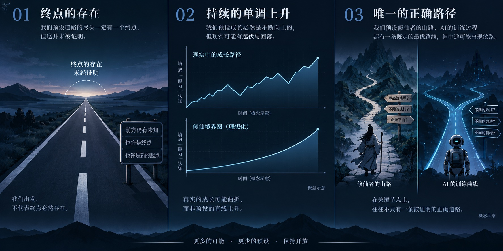
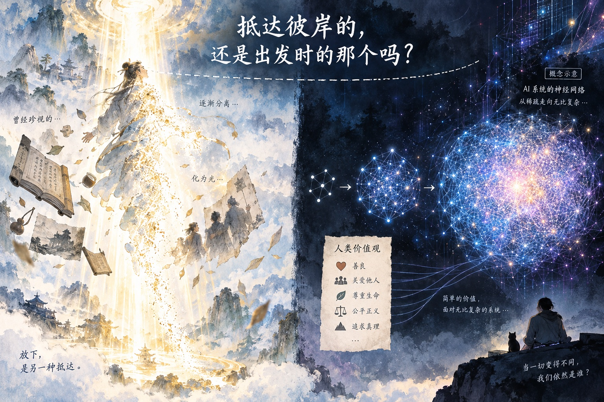

# 以有涯逐无涯：修仙与 AI 共享的认知困境

**副标题：** 我们用来想象「超越」的工具，本身就是需要被超越的东西

---

> *以有涯随无涯，殆已。*
> ——《庄子·养生主》

庄子说，用有限的生命去追求无限的知识，是危险的。他说的不只是时间不够用。他说的是：**追求本身，就是一个结构性的困境。**

两千年后，人类造出了另一种追求无限的方式，叫做人工智能。同时，修仙小说里的修士们也在用另一种方式追求同一件事。

这篇文章不是要找两件事之间有多少相似点。它想回答一个更根本的问题：**为什么人类一旦开始追求「超越」，总是掉进同一个结构性的陷阱？**

---

## 一、同一个欲望的考古

在讨论 AI 和修仙之前，先做一件事：把两者都放进更大的历史背景里。

几乎每一个文明，都独立发展出了「超越性叙事」：

- 古希腊有「神化」（Apotheosis）——英雄通过试炼，从凡人变成半神
- 基督教有与神合一（Theosis）——灵魂通过修炼，最终与创造者合并
- 佛教有涅槃——通过系统性的修行，抵达一个超越轮回的存在状态
- 道家有飞升成仙——通过修炼，突破生死，成为与天道同构的存在
- 现代科技主义有技术奇点（Singularity）——通过创造超级智能，进入一个人类无法预测的新时代

这些叙事的时代不同、文化不同，但目标结构**惊人地一致**：

1. 存在一个当前状态（凡人/有限智能）
2. 存在一个目标状态（神仙/AGI），它比当前状态在本质上更优越
3. 存在一条路径（修炼/技术路线图），可以从 1 通往 2
4. 到达目标状态后，存在的本质将发生不可逆的质变

**修仙和 AI 不是偶然相似——它们是同一个人类欲望在不同历史时期的两次实例化。**

理解了这一点，很多表面上有趣的类比就不再只是有趣了——它们开始指向同一个结构性问题。

<figure>
  
  <figcaption>历史长卷：超越的想象 · AI 生成概念示意</figcaption>
</figure>

---

## 二、阶梯：不是发现，是认知妥协

为什么修仙小说一定要有境界体系？为什么 AI 研究者一定要构建能力分级？

一个常见的解释是：「因为这样便于读者/受众理解进度」。但这个解释太浅——它只说了「有用」，没说「为什么必要」。

更深的原因是：**人类的认知无法直接表征一个质变后的存在状态。**

想象一下「成仙后的状态」。你能想象的，大概是「比现在更强大、寿命更长、更自由」——本质上是对当前状态的放大和延伸。你无法想象一种与人类认知结构根本不同的存在方式，因为你只有人类的认知来做这件事。

这是一个认识论的根本困难，叫做**认知封闭性（Cognitive Closure）**：某些问题可能超出了提问者的认知能力范围，不是因为信息不够，而是因为解答这类问题所需的认知工具，我们根本没有。

「阶梯」是对这个困难的一种解决方案——一种**认知妥协**：我无法直接想象终点，但我可以想象「比现在好一点点」。把无数个「好一点点」串起来，就构成了通往终点的阶梯。

这个妥协是有代价的：

**代价一：终点被重新定义为「当前状态的无限延伸」，而不是「本质不同的状态」。**

修仙的「飞升」在小说里其实是「变成一个更厉害的修仙者」，而不是「变成一种人类无法理解的存在」。AGI 在大多数讨论里也是「一个在所有任务上都比人类强的系统」，而不是「一种人类可能根本无法评估其行为的智能」。

**代价二：进步的标准被锁定在当前的测量工具上。**

这是一个测量悖论：你只能用你现有的认知评估你是否在进步。但如果你要达到的目标与你的现有认知在本质上不同，那么你的测量工具本身就是不够用的。

修仙者如何知道自己真的在进步，而不是在幻境里原地打转？他们用的是当前境界的标准来测量。AI 研究者如何知道 GPT-5 比 GPT-4 真的「更智能」，而不只是「在当前基准测试上得分更高」？他们用的也是当前认知框架下的标准。

**Scaling Law 在 AI 领域扮演的角色，与「天道」在修仙世界扮演的角色，在认识论上完全相同：** 它不只是一条经验规律，它是整个测量体系的合法性基础。「只要顺应天道，努力就会有回报」和「只要参数量够大、数据够多，模型性能就会提升」——两者都在为行动提供一个不需要追问的理由。

2023 年前后，OpenAI 内部因 Scaling Law 是否仍然有效产生了深刻的分歧，这场争论最终引发了 Sam Altman 的短暂出走和董事会危机。修仙小说里，一旦有人开始质疑天道，整个修真界都会陷入动荡。**这不是巧合，是同一个认知结构在不同介质里的相同反应。**

---

## 三、奇异循环：超越者永远是被超越对象的一部分

这是全文哲学核心。

哲学家 Douglas Hofstadter 在《哥德尔、艾舍尔、巴赫》和《我是个奇怪的循环》中提出了「奇异循环」（Strange Loop）的概念：一个系统在试图描述或超越自身时，总是不可避免地回到自身。

哥德尔不完备性定理是这个思想的严格数学版本：任何足够强大的形式系统，都包含在该系统内部无法证明其真假的命题。简单说：**一个足够复杂的系统，无法从内部完全描述自己。**

这个定理的哲学推论，直接击中了修仙和 AI 共同面对的核心困境：

> **任何试图超越自身的系统，都必须使用自身来定义「超越」意味着什么。这使得「超越」的定义不可避免地包含了它试图超越的局限性。**

用修仙的语言说：修仙者用凡人的心，定义了「成仙」的样子。这个「成仙」的样子，因此是凡人对神仙的想象，不是神仙本身。

用 AI 的语言说：人类用人类的智能，定义了「超人类智能」的样子。这个定义，因此是人类对超人类的投影，不是超人类本身。

<figure>
  
  <figcaption>奇异循环与自我超越 · AI 生成概念示意</figcaption>
</figure>

这个循环在实践中产生了两个具体后果：

**后果一：AI 对齐目标的内在不稳定性。**

对齐（Alignment）的目标是让 AI 系统的行为符合「人类价值观」。但「人类价值观」是什么？是现在的人类价值观，还是更好的未来人类价值观？现在的人类价值观里充满了偏见、矛盾和历史局限——奴隶制曾经是「人类价值观」的一部分。

如果我们用 RLHF（人类反馈强化学习）对齐模型，我们实际上是在把一个历史特定时刻的人类偏好，编码进一个可能会运行几十年甚至更久的系统。我们在用今天的凡人心，塑造明天的神仙样。

**后果二：修仙境界的本质问题。**

修仙小说里，每一个境界都是由更高境界的存在定义的——筑基的目标由金丹来定义，金丹的目标由元婴来定义。但谁定义了「飞升之后」？在到达那个境界之前，没有人真正知道它是什么——人们只是假设它比之前的境界「更好」。

这意味着：整个修仙体系实际上是在用当前阶段的理解，构建对下一阶段的投影，层层叠加，最终构建出一个「终点」的概念。这个终点是想象力的产物，不是客观描述。

AI 领域的「AGI」概念，也有类似的问题：它是当前人类用当前认知能力想象的「更好版本」，不是一个独立于人类认知的客观目标。

---

## 四、资源、权力与「谁来定义终点」

<figure>
  
  <figcaption>资源与定义权 · AI 生成概念示意</figcaption>
</figure>

修仙小说里有一个永恒的张力：**大宗门垄断核心资源，从而垄断了定义「正确路径」的权力。**

这不是文学创作，是任何高代价「超越性项目」在资源约束下必然出现的组织形态：

| 修仙世界 | AI 世界 |
|---------|---------|
| 灵石/灵矿 | GPU 算力/能源 |
| 功法秘籍 | 模型权重/训练数据 |
| 大宗门 | OpenAI / Google DeepMind / Anthropic |
| 出走弟子另立门户 | Anthropic 从 OpenAI 分裂出去 |
| 强制公开功法的「侠客」 | Meta 开源 LLaMA 系列 |
| 散修江湖 | Hugging Face 生态/开源社区 |

但这张表格的真正重点不是对应关系，而是它揭示的权力结构：

**当超越的代价极其高昂，资源控制者获得的不只是竞争优势，而是定义「AGI 长什么样」的话语权。**

OpenAI 最初是非营利研究机构，使命是确保 AGI 对全人类有益。现在它是一家估值超过三千亿美元的商业公司。这不是道德堕落，这是结构必然——任何追求极高代价目标的组织，都会逐渐被资源逻辑重塑，直到「使命」与「生存」之间取得某种妥协。

修仙宗门的历史与此完全平行。值得追问的是：**当定义终点的权力集中在少数人手里，这个终点究竟是对「超越」的客观描述，还是对特定利益的合理化？**

---

## 五、心魔即自我：对齐问题的哲学本质

修仙者在突破关键境界时遭遇「心魔」。心魔是什么？

不是外部敌人，**是修仙者自己过去的执念、恐惧、欲望的内化与投影**。越往高处修炼，越需要放下「人」的部分——而你放不下的那部分，就变成阻碍你继续超越的障碍。

这里有一个深刻的反讽：**修仙者越成功，他越接近需要消灭自我的那一刻。成功的终极代价，是超越者本身。**

AI 对齐问题在结构上完全复现了这个困境，但复杂度更高一级：

我们在训练一个可能超越人类智能的系统，但我们只能用人类的价值观、人类的标注数据、人类的目标函数去训练它。每一个训练信号都在将人类的局限性编织进系统——我们试图创造超越人类的智能，却在每一步训练中把「人类性」编码得更深。

这就是奇异循环的实践版本：

> **被困于生物性局限的人类，用自身局限性作为材料，试图构造一个超越这些局限的存在。**

<figure>
  
  <figcaption>自我镜像与认知边界 · AI 生成概念示意</figcaption>
</figure>

更深的问题在于：「对齐」到底是对齐到什么？

- 对齐到**今天的人类偏好**——那意味着我们把历史上某个特定时刻的偏见和局限，永久地编码进了一个长期存在的系统
- 对齐到**更好的未来价值观**——但谁来定义「更好」？用什么标准？站在哪个位置？

修仙者解决心魔的方式，在叙事上是「彻悟」——某个关键时刻突然想通了，执念消散，境界突破。这在小说里有效，因为作者控制了宇宙。在现实里，心魔没有这么体面的解决方式，因为执念和价值观是一体两面，你无法在保留价值判断的同时消灭所有执念。

AI 对齐领域目前最诚实的状态，是**我们知道问题的结构，但不知道答案**。这和修仙者知道心魔是什么、但不知道如何真正渡过它，是同一种处境。

---

## 六、目的论的三个陷阱

修仙小说有一个类型契约：**主角最终一定会成功**。这不是情节设定，这是读者与作者之间的默认协议：翻开书，就默认了目的地的存在和可达性。

当这个默认被不加审视地带入现实决策框架，它变成了三个从未被充分证明的预设：

**预设一：AGI 必然存在，区别只是时间。**

修仙叙事里「飞升必然可达」的翻版。但我们真正有的证据是：Scaling Law 在若干维度上有效，以及一系列令人印象深刻的涌现能力。我们没有的是：任何理论能证明「在参数量/计算量的某个阈值上，必然出现通用智能」。涌现能力的存在，证明的是「量变可以引起质变」，不是「这条路的终点是 AGI」。

**预设二：能力提升是单调的，不存在真正的退步。**

修仙小说里境界只会向上。现实里，很多模型在某方面能力提升的同时出现其他能力的退化（capability regression）；很多看似突破的能力后来被发现是对特定测试分布的过拟合。发展路径的复杂度远超境界图的线性想象。

**预设三：当前路径（Transformer + Scaling）可以走到终点。**

修仙者默认自己当前修炼的功法是正确的。但每一次技术范式的真正突破，推动它的往往不是原有路径的继续加速，而是结构性的范式切换。Transformer 可能是通往 AGI 的正确路径，也可能只是当前算力约束下的局部最优——一个非常高效的、但通往另一个终点的功法。

<figure>
  
  <figcaption>三个未经证明的预设 · AI 生成概念示意</figcaption>
</figure>

这三个预设都没有被证伪，但它们也都没有被充分证明。**整个行业的资本流向、人才分配、地缘政治竞争，都建立在这三个预设之上——这本身就是一种信仰行为，与修仙世界对「天道」的信仰在功能上等价。**

---

## 七、飞升悖论：抵达彼岸的人，还是出发时的你吗

这是修仙叙事从未认真处理过的问题，也是 AI 发展叙事中最被忽视的哲学维度。

哲学上有一个「忒修斯之船」的悖论：如果一艘船的每一块木板都被逐渐替换，最终一块原来的木板都不剩——它还是原来那艘船吗？

修仙的逻辑推演到极致，面对的是更激烈的版本：

修仙的目标是超越人类的局限性。**但人类的局限性，与人类的存在体验，并不是完全分离的两件事。** 你的情感、记忆、偏好、对他人的在意——这些构成了「你是谁」的一部分，也是你生物性局限的一部分。随着修仙境界的提升，这些「人性」成分被逐渐削减——因为它们本来就是你试图超越的东西。

那么问题来了：**飞升成仙的那个存在，和最初开始修仙的那个人，究竟是什么关系？**

修仙小说通常用情感的保留来回答这个问题——仙人仍然记得凡间的情，有时还会回来渡化旧识。但这个答案是叙事层面的，不是哲学层面的。它的作用是让读者感到「成仙后的主角还是我们认识的那个人」，而不是真正探讨超越意味着什么。

同样的问题以另一种形式出现在 AI 发展叙事里：

如果我们成功创造了一个超级智能，并且它是「对齐的」——对齐到哪个时刻的人类价值观？训练完成时的？五年后的？对齐意味着「与人类价值观保持一致」，但如果这个系统的智能已经远超人类，它和人类价值观的关系是「遵守」，还是「理解我们甚至无法表达的更好价值观，但用我们能理解的方式行动」？

**更根本的问题是：一个在认知层面上与人类有本质差异的存在，是否还有意义谈「与人类保持一致」？**

<figure>
  
  <figcaption>飞升与身份的连续性 · AI 生成概念示意</figcaption>
</figure>

---

## 八、尾声：庄子的问题还没有答案

庄子说「以有涯随无涯，殆已」，不是在劝人放弃追求。他是在提醒：追求本身有一个结构性的危险——当你用有限的工具去追求无限，你很可能不是在接近「无限」，而是在制造一个「有限」的放大版本，然后把它误认为是无限。

修仙文化和 AI 发展，都面对着这个两千年前就被提出来的问题。

它们给出的答案，在形式上是相同的：构建阶梯，顺序攀爬，相信终点存在。这个答案有很强的实用性——它提供了方向感、激励机制和行动框架。但它没有解决庄子的问题，它只是暂时绕开了它。

这篇文章不是在说修仙追求是虚妄的，或者 AI 研究是危险的。大多数具体的工作——无论是算法优化、安全研究，还是能力评测——都有其确实的价值。

这篇文章想说的，是一件更小但更紧迫的事：

**在这两个领域里，都存在一批人，他们对「终点」的信念已经强大到不需要质疑的程度。** 在修仙世界，这叫「道心坚定」，是美德。在现实的技术发展里，这有时意味着：思考停止了，资源堆砌开始了，每一个质疑都被当作「不够虔诚」来处理。

修仙小说里有一种境界叫「走火入魔」——修炼者过于执着于突破，反而被执念本身所困，陷入幻境，以为自己在进步，实际上已经偏离了正道。

区别走火入魔与真正突破的方式，在修仙叙事里通常是「回到初心」——重新问自己最初为什么修炼，自己到底在追求什么。

这个问题，在 AI 领域同样值得不时地问一遍。

---

*全文约 6800 字*

---
