# 你的应用真的需要 Thinking 模式吗？推理时计算扩展的工程代价

> **作者按**：Qwen3 刚刚发布全系列，从 0.6B 到 235B 全线支持"混合思考模式"；DeepSeek-R1 的 `<think>` 标签早已成为开发者的口头禅；o3 的推理能力在各大 Benchmark 上碾压一切。一时之间，「Thinking 模式」成了 AI 工程的新宠。
>
> 但我想泼一盆冷水：**Thinking 不是免费的，也不是万能的。** 这篇文章从工程视角拆解推理时计算扩展的技术逻辑、代价与适用边界——帮你在选型时做出真正理性的判断。

---

<figure>
  
  <figcaption>快思与慢思 · AI 生成概念示意</figcaption>
</figure>


---

## 一、一个工程师该问的问题

2025 年底到 2026 年初，一个现象悄然发生：几乎所有主流大模型都开始标配"推理模式"：

- **OpenAI** 的 o1、o3 系列，把"思考"作为核心卖点
- **DeepSeek-R1** 用开源的方式把推理链 `<think>...</think>` 直接暴露给开发者
- **Qwen3** 更进一步，提供 `enable_thinking=True/False` 的工程开关，让快思/慢思随时切换

于是很多工程师的第一反应是：**直接全部打开 Thinking，准确率不就更高了？**

这个问题的答案，取决于你对以下几个数字是否有清醒的认识：

| 指标 | 关闭 Thinking | 开启 Thinking |
|:---|:---:|:---:|
| 首 Token 延迟 | ~0.5 秒 | **5–60 秒** |
| 单次请求 Token 消耗 | ~500 tokens | **2,000–20,000 tokens** |
| 成本倍率 | 1x | **10–50x** |
| 数学/代码准确率提升 | - | **+15–30%** |
| 翻译/摘要准确率提升 | - | **<2%（可忽略）** |

如果你的应用是实时客服，那首 Token 延迟 60 秒意味着用户早就关掉了页面。如果你的任务是生成营销文案，花 50 倍的成本换来 2% 的质量提升，这笔账根本不划算。

> 工程判断的本质，不是"哪个模型更好"，而是"什么场景下，什么模型是最优解"。

---

## 二、Scaling Law 遇到了天花板

要理解 Thinking 模式为何会出现，先要理解它是为了解决什么问题。

### 训练时扩展的辉煌与困境

2020 年，OpenAI 提出了著名的 Scaling Law：模型能力与训练算力、参数量、数据量呈幂律关系增长——简单来说，**堆算力就能堆能力**。这一定律支撑了从 GPT-3 到 GPT-4 的整个时代。

但到了 2024 年前后，这条路开始变得越来越昂贵：

<figure class="article-diagram">
  <a href="/assets/diagrams/articles/2026-04-07-thinking-mode-engineering-cost-01.svg" target="_blank" rel="noopener" aria-label="打开原图：AI Scaling 范式演进">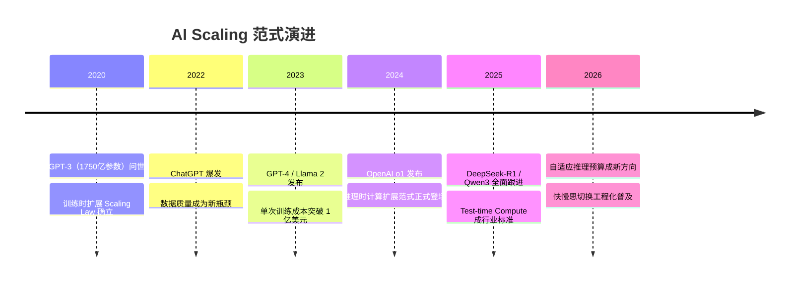</a>
  <figcaption>AI Scaling 范式演进 · <a href="/assets/diagrams/articles/2026-04-07-thinking-mode-engineering-cost-01.svg" target="_blank" rel="noopener">查看原图</a> · <a href="/assets/diagrams/articles/2026-04-07-thinking-mode-engineering-cost-01.mmd" download>图表源文件</a></figcaption>
</figure>
问题出在两个地方：

1. **数据瓶颈**：互联网上高质量文本是有限的。据估计，到 2026 年，人类已产出的高质量文本已基本被主流模型消耗殆尽。
2. **成本曲线陡峭**：GPT-4 训练成本约 1 亿美元，再往上扩展 10 倍需要 10 亿美元，但能力提升远不到 10 倍。

<figure>
  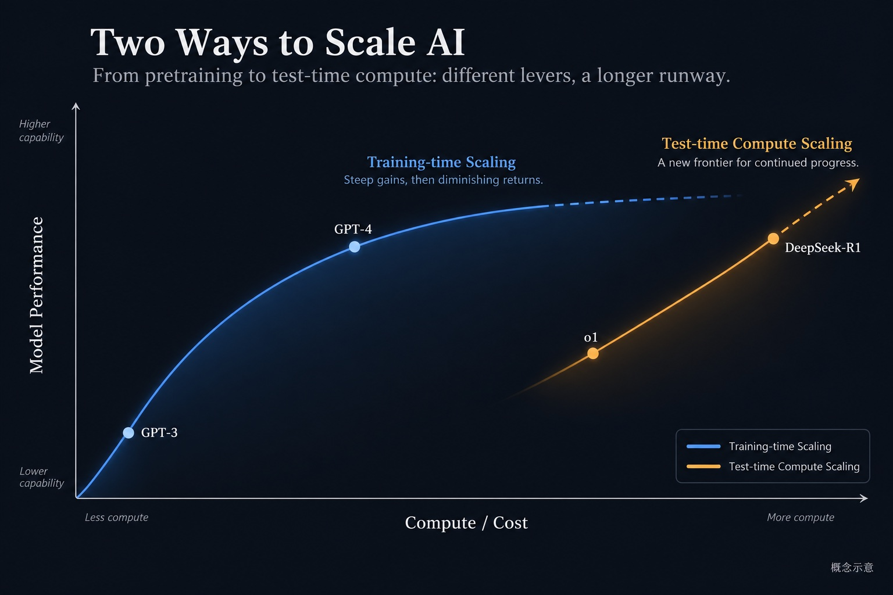
  <figcaption>训练与推理时扩展 · AI 生成概念示意</figcaption>
</figure>


### 推理时扩展：让模型"多想一会儿"

既然训练时堆算力的边际收益在递减，研究者开始思考另一个方向：**推理时能不能让模型使用更多计算？**

这就是 Test-time Compute Scaling 的核心思路：不改变模型权重，而是在推理阶段动态分配更多计算资源——让模型自己"想多几步"。

---

## 三、从 CoT 到 MCTS：推理时计算的技术演化

推理时计算的技术并非一蹴而就，而是经历了从简单到复杂的演进路线：

<figure class="article-diagram">
  <a href="/assets/diagrams/articles/2026-04-07-thinking-mode-engineering-cost-02.svg" target="_blank" rel="noopener" aria-label="打开原图：流程与关系图"></a>
  <figcaption>流程与关系图 · <a href="/assets/diagrams/articles/2026-04-07-thinking-mode-engineering-cost-02.svg" target="_blank" rel="noopener">查看原图</a> · <a href="/assets/diagrams/articles/2026-04-07-thinking-mode-engineering-cost-02.mmd" download>图表源文件</a></figcaption>
</figure>
**Chain-of-Thought（CoT）**：最简单的推理时扩展。让模型输出"步骤 1… 步骤 2…"，通过中间过程提升最终答案准确性。这是 Prompt Engineering 层面的技巧。

**Tree-of-Thought（ToT）**：将线性推理链升级为树状结构。模型同时探索多条推理路径，最终选取最优路径。计算量显著增加，但在复杂规划类任务上效果明显。

**蒙特卡洛树搜索（MCTS）**：借鉴 AlphaGo 的搜索算法。用 Value Model 对每一步推理打分，通过反复采样和回溯找到最优解。这是目前理论上最强的推理时计算框架，也是计算成本最高的。

> **关键洞察**：这三种方法的本质都是"用更多推理 Token 换取更高准确率"。Token 消耗从 50 到 5000+，代价差了 100 倍。

---

## 四、三大主流实现的工程对比

理解了技术原理，再看三个主流实现的工程取舍，就清晰很多了。

| 维度 | OpenAI o1 / o3 | DeepSeek-R1 | Qwen3 |
|:---|:---:|:---:|:---:|
| 开源协议 | ❌ 闭源 | ✅ MIT | ✅ Apache 2.0 |
| 推理链可见性 | 🔒 不可见 | 📖 `<think>` 标签可见 | 🔧 可选显示 |
| 训练方法 | 闭源 RLHF+RL | GRPO（无需 Critic）| 混合训练 |
| 可蒸馏 | ❌ | ✅ 7B/14B/32B | ✅ 全系列 |
| 工程开关 | ❌ 固定预算 | ❌ 始终 Thinking | ✅ `enable_thinking` |
| 参数规模 | 未知 | 671B MoE（激活 37B）| 0.6B ~ 235B |
| 相对成本 | 💰💰💰 最高 | 💰💰 中等 | 💰 最灵活 |
| 准确率上限 | ⭐⭐⭐⭐⭐ | ⭐⭐⭐⭐⭐ | ⭐⭐⭐⭐ |

**① OpenAI o1 / o3 — 黑盒推理**

<figure class="article-diagram">
  <a href="/assets/diagrams/articles/2026-04-07-thinking-mode-engineering-cost-03.svg" target="_blank" rel="noopener" aria-label="打开原图：流程与关系图"></a>
  <figcaption>流程与关系图 · <a href="/assets/diagrams/articles/2026-04-07-thinking-mode-engineering-cost-03.svg" target="_blank" rel="noopener">查看原图</a> · <a href="/assets/diagrams/articles/2026-04-07-thinking-mode-engineering-cost-03.mmd" download>图表源文件</a></figcaption>
</figure>
**② DeepSeek-R1 — 显式推理链 + GRPO**

<figure class="article-diagram">
  <a href="/assets/diagrams/articles/2026-04-07-thinking-mode-engineering-cost-04.svg" target="_blank" rel="noopener" aria-label="打开原图：流程与关系图"></a>
  <figcaption>流程与关系图 · <a href="/assets/diagrams/articles/2026-04-07-thinking-mode-engineering-cost-04.svg" target="_blank" rel="noopener">查看原图</a> · <a href="/assets/diagrams/articles/2026-04-07-thinking-mode-engineering-cost-04.mmd" download>图表源文件</a></figcaption>
</figure>
**③ Qwen3 — 快慢思混合模式**

<figure class="article-diagram">
  <a href="/assets/diagrams/articles/2026-04-07-thinking-mode-engineering-cost-05.svg" target="_blank" rel="noopener" aria-label="打开原图：流程与关系图"></a>
  <figcaption>流程与关系图 · <a href="/assets/diagrams/articles/2026-04-07-thinking-mode-engineering-cost-05.svg" target="_blank" rel="noopener">查看原图</a> · <a href="/assets/diagrams/articles/2026-04-07-thinking-mode-engineering-cost-05.mmd" download>图表源文件</a></figcaption>
</figure>
### DeepSeek-R1：GRPO 是关键

DeepSeek-R1 之所以在开源界引发震动，核心在于它用了一种非常"省钱"的训练方法——**GRPO（Group Relative Policy Optimization）**。

传统的 RLHF（基于人类反馈的强化学习）需要一个 Critic Model 来评估每一步的好坏，这本质上是另一个大模型，训练成本翻倍。

GRPO 的做法是：**在同一个问题下，采样一组答案，用组内相对奖励代替绝对评分**。

<figure class="article-diagram">
  <a href="/assets/diagrams/articles/2026-04-07-thinking-mode-engineering-cost-06.svg" target="_blank" rel="noopener" aria-label="打开原图：流程与关系图"></a>
  <figcaption>流程与关系图 · <a href="/assets/diagrams/articles/2026-04-07-thinking-mode-engineering-cost-06.svg" target="_blank" rel="noopener">查看原图</a> · <a href="/assets/diagrams/articles/2026-04-07-thinking-mode-engineering-cost-06.mmd" download>图表源文件</a></figcaption>
</figure>
**GRPO 的工程优势**：不需要 Critic Model，训练内存占用更低，梯度信号来自组内对比，在数学/代码等有明确答案的任务上非常稳定。这也是 DeepSeek 能用约 556 万美元完成 R1 训练的核心原因之一。

### Qwen3：工程师最友好的设计

Qwen3 的混合思考模式是目前工程实践上最灵活的设计。同一个模型，通过 `enable_thinking` 参数动态切换推理深度：

```python
# 开启 Thinking 模式（适合数学/代码/逻辑推理）
response = model.chat(
    messages=[{"role": "user", "content": "证明√2是无理数"}],
    enable_thinking=True   # 模型会输出完整思维链
)

# 关闭 Thinking 模式（适合翻译/摘要/闲聊）
response = model.chat(
    messages=[{"role": "user", "content": "帮我翻译这段英文"}],
    enable_thinking=False  # 直接输出答案，延迟低
)
```

这种设计背后是**混合训练策略**：Qwen3 在训练时同时使用了 Thinking 数据和 Non-Thinking 数据，使得同一组权重具备两种推理能力。这是目前已知的商业/开源模型中工程灵活性最高的方案。

---

## 五、工程代价的量化分析

说完技术原理，到了最核心的部分——**量化 Thinking 模式真实的工程成本**。

<figure>
  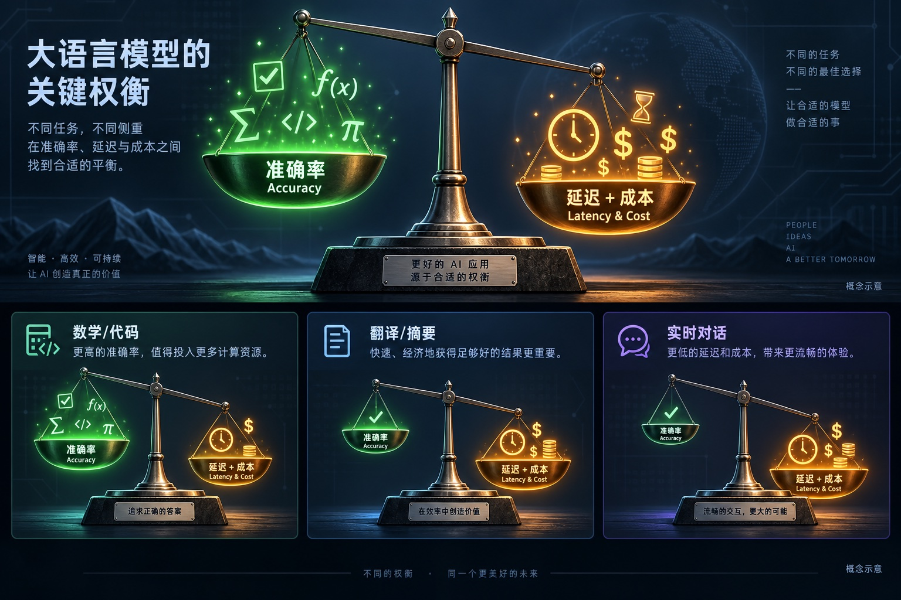
  <figcaption>准确率、延迟与成本 · AI 生成概念示意</figcaption>
</figure>


### 5.1 延迟：首 Token 延迟是致命伤

Thinking 模式下，模型需要先完成整个思考过程，才能开始输出最终答案。这意味着**首 Token 延迟（Time to First Token, TTFT）会大幅增加**：

<figure class="article-diagram">
  <a href="/assets/diagrams/articles/2026-04-07-thinking-mode-engineering-cost-07.svg" target="_blank" rel="noopener" aria-label="打开原图：不同模式下首 Token 延迟对比（秒）">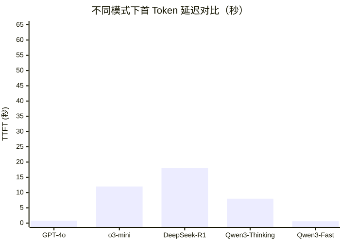</a>
  <figcaption>不同模式下首 Token 延迟对比（秒） · <a href="/assets/diagrams/articles/2026-04-07-thinking-mode-engineering-cost-07.svg" target="_blank" rel="noopener">查看原图</a> · <a href="/assets/diagrams/articles/2026-04-07-thinking-mode-engineering-cost-07.mmd" download>图表源文件</a></figcaption>
</figure>
> **工程红线**：对于面向用户的实时交互产品，TTFT 超过 3 秒就会显著影响用户体验，超过 10 秒会导致大量用户放弃。Thinking 模式在这类场景下基本不可用。

### 5.2 成本：Token 消耗是乘法关系

API 计费通常按 Token 计，Thinking 模式会产生大量"内部推理 Token"，有些平台单独计费，有些算在总 Token 里：

<figure class="article-diagram">
  <a href="/assets/diagrams/articles/2026-04-07-thinking-mode-engineering-cost-08.svg" target="_blank" rel="noopener" aria-label="打开原图：单次请求 Token 消耗估算（典型数学题）">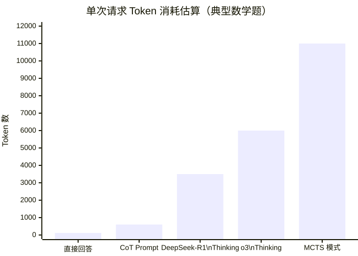</a>
  <figcaption>单次请求 Token 消耗估算（典型数学题） · <a href="/assets/diagrams/articles/2026-04-07-thinking-mode-engineering-cost-08.svg" target="_blank" rel="noopener">查看原图</a> · <a href="/assets/diagrams/articles/2026-04-07-thinking-mode-engineering-cost-08.mmd" download>图表源文件</a></figcaption>
</figure>
以 DeepSeek-R1 API 为例（输入 $0.55/M tokens，输出 $2.19/M tokens），一道复杂数学题：
- 非 Thinking：约 $0.001
- Thinking 开启：约 $0.015（约 **15 倍**）

对于高并发场景（如 1000 QPS），月成本差距可以达到 **百万人民币量级**。

### 5.3 收益不均匀：任务类型决定是否值得

Thinking 模式的提升高度依赖任务类型：

| 任务类型 | 准确率提升 | 工程代价 | 建议 |
|:---|:---:|:---:|:---:|
| 数学证明 / 竞赛编程 | +25~30% | 高 | ✅ 强烈推荐 |
| 逻辑推理 / 复杂 SQL | +15~22% | 高 | ✅ 推荐 |
| 代码补全 / 调试 | +10~15% | 中高 | ✅ 视复杂度 |
| 内容摘要 / 翻译 | <2% | 中 | ❌ 不推荐 |
| 实时客服 / 闲聊 | <1% | 极高（延迟） | ❌ 禁止 |

<figure class="article-diagram">
  <a href="/assets/diagrams/articles/2026-04-07-thinking-mode-engineering-cost-09.svg" target="_blank" rel="noopener" aria-label="打开原图：Thinking 模式开启后准确率提升幅度（%）">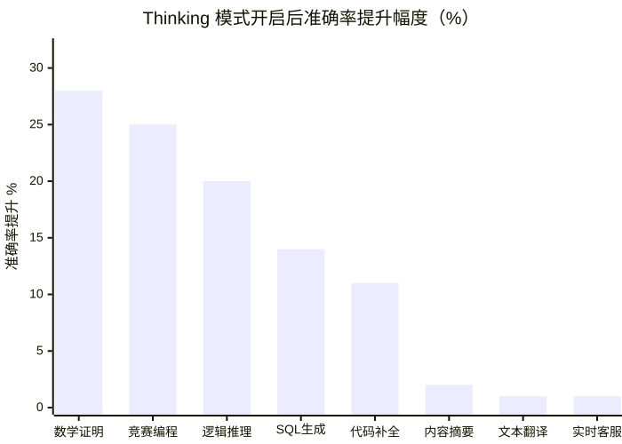</a>
  <figcaption>Thinking 模式开启后准确率提升幅度（%） · <a href="/assets/diagrams/articles/2026-04-07-thinking-mode-engineering-cost-09.svg" target="_blank" rel="noopener">查看原图</a> · <a href="/assets/diagrams/articles/2026-04-07-thinking-mode-engineering-cost-09.mmd" download>图表源文件</a></figcaption>
</figure>
**结论清晰**：数学证明、竞赛编程、复杂逻辑推理——开启 Thinking，准确率提升明显值得代价；翻译、摘要、客服对话——开启 Thinking 是在烧钱。

---

## 六、模型选型的工程决策框架

基于上面的分析，这里给出一个可落地的工程决策流程：

<figure class="article-diagram">
  <a href="/assets/diagrams/articles/2026-04-07-thinking-mode-engineering-cost-10.svg" target="_blank" rel="noopener" aria-label="打开原图：流程与关系图"></a>
  <figcaption>流程与关系图 · <a href="/assets/diagrams/articles/2026-04-07-thinking-mode-engineering-cost-10.svg" target="_blank" rel="noopener">查看原图</a> · <a href="/assets/diagrams/articles/2026-04-07-thinking-mode-engineering-cost-10.mmd" download>图表源文件</a></figcaption>
</figure>
### 补充：蒸馏版是高并发的最优解

值得单独强调的是**蒸馏技术**（Knowledge Distillation）的工程价值。

DeepSeek-R1 开源之后，社区基于其输出数据蒸馏出了一系列轻量版本：

| 模型 | 参数量 | 相对 R1 满血版准确率 | 推理成本 |
|:---|:---:|:---:|:---:|
| DeepSeek-R1 | 671B (MoE, 37B激活) | 100% 基准 | 高 |
| R1-Distill-Qwen-32B | 32B | ~93% | 中 |
| R1-Distill-Qwen-14B | 14B | ~88% | 低 |
| R1-Distill-Qwen-7B | 7B | ~82% | 极低 |

对于多数业务场景，14B 蒸馏版在准确率上已完全够用，而成本可以降低 5–10 倍。这是高并发推理任务的首选路线。

---

## 七、现状与争议：Benchmark 真的可信吗？

当然，这个领域并非没有争议。

2025 年 Llama 4 发布后，社区爆发了激烈的 **Benchmark 污染讨论**：Meta 公布的各项指标远超实际使用体验，被大量开发者质疑测试集泄露。这一事件让整个行业重新审视 Benchmark 的可信度。

<figure class="article-diagram">
  <a href="/assets/diagrams/articles/2026-04-07-thinking-mode-engineering-cost-11.svg" target="_blank" rel="noopener" aria-label="打开原图：流程与关系图"></a>
  <figcaption>流程与关系图 · <a href="/assets/diagrams/articles/2026-04-07-thinking-mode-engineering-cost-11.svg" target="_blank" rel="noopener">查看原图</a> · <a href="/assets/diagrams/articles/2026-04-07-thinking-mode-engineering-cost-11.mmd" download>图表源文件</a></figcaption>
</figure>
> **工程师的实践建议**：永远不要只看 Benchmark 选模型。用你自己的 100–1000 条真实业务数据做对比测试，那才是你的模型的真实表现。

---

## 八、未来：让模型自己决定"该不该想"

目前 Thinking 模式还需要开发者手动配置。但这本身就是一种不够优雅的工程设计——为什么不让模型自己判断这个问题需要深度推理，还是直接回答？

Qwen3 的混合思考模式已经是这个方向的雏形。未来的演进方向可能是：

<figure class="article-diagram">
  <a href="/assets/diagrams/articles/2026-04-07-thinking-mode-engineering-cost-12.svg" target="_blank" rel="noopener" aria-label="打开原图：Thinking 模式技术演进路线">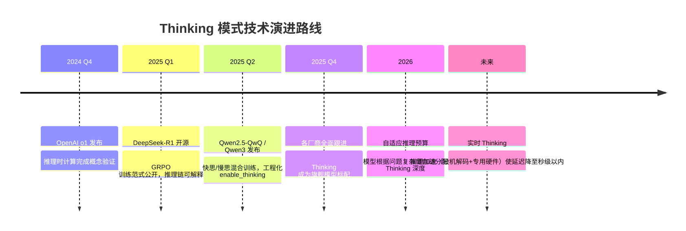</a>
  <figcaption>Thinking 模式技术演进路线 · <a href="/assets/diagrams/articles/2026-04-07-thinking-mode-engineering-cost-12.svg" target="_blank" rel="noopener">查看原图</a> · <a href="/assets/diagrams/articles/2026-04-07-thinking-mode-engineering-cost-12.mmd" download>图表源文件</a></figcaption>
</figure>
**自适应推理预算（Adaptive Compute Budget）** 是下一个技术热点：模型能够根据问题难度动态分配 Thinking Token——简单问题直接回答，复杂问题深度推理，且无需开发者干预。部分研究（如 Budget Forcing、Thinking Token Prediction）已在探索这个方向。

---

## 九、结语

回到开篇的问题：**你的应用真的需要 Thinking 模式吗？**

答案不是"是"，也不是"否"，而是——**取决于你对任务类型、延迟要求和成本预算的清醒认知**。

工程师的价值，从来不是选最贵的方案，而是找到**准确率、延迟、成本三维度的帕累托最优点**。

几个可以直接带走的结论：

1. **Thinking 模式只对有明确正确答案、可验证的任务有显著收益**（数学、代码、逻辑），对生成类任务几乎无效
2. **实时交互场景不要开 Thinking**，首 Token 延迟是硬约束
3. **高并发场景优先考虑蒸馏版**，14B 蒸馏模型在多数场景的性价比远高于 671B 满血版
4. **Qwen3 的 `enable_thinking` 设计是目前工程灵活性最佳的方案**，推荐作为自建推理服务的首选
5. **不要只看 Benchmark**，用你的真实业务数据测试才是正解

AI 的进步让"更聪明"变得更便宜，但工程的本质依然是权衡。**理解代价，才能用好能力。**

---

## 参考资料

- DeepSeek-R1 技术报告：[arXiv:2501.12948](https://arxiv.org/abs/2501.12948)
- Qwen3 官方发布博客：[Qwen Blog](https://qwenlm.github.io/blog/qwen3/)
- OpenAI o3 System Card：[OpenAI](https://openai.com/index/openai-o3-system-card/)
- Scaling LLM Test-Time Compute Optimally：[arXiv:2408.03314](https://arxiv.org/abs/2408.03314)
- Tree of Thoughts：[arXiv:2305.10601](https://arxiv.org/abs/2305.10601)

---

*本文所有延迟和成本数据均为 2026 年 4 月时点的估算，受 API 定价调整影响，以各平台官方文档为准。*

---
