# Harness 全平台深度解析：面向研发工程师的现代 DevOps 实践指南

<figure>
  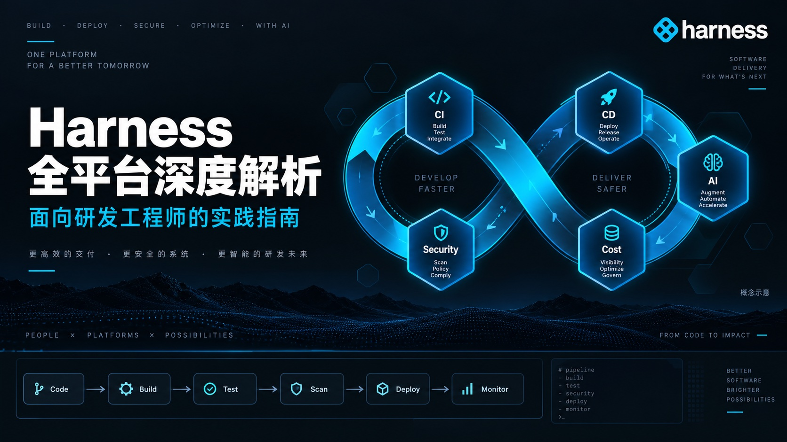
  <figcaption>Harness 平台全景 · AI 生成概念示意</figcaption>
</figure>

> **作者注**：本文基于 Harness 2024-2026 年最新技术动态撰写，面向有一定 DevOps 实践经验的研发工程师，旨在从技术原理层面系统性介绍 Harness 平台的架构设计、核心机制与工程实践。

---

## 目录

1. [现代软件交付的挑战](#1-现代软件交付的挑战)
2. [Harness 平台全景架构](#2-harness-平台全景架构)
3. [核心引擎：Delegate 机制深度解析](#3-核心引擎delegate-机制深度解析)
4. [CI 模块：智能构建加速三剑客](#4-ci-模块智能构建加速三剑客)
5. [CD & GitOps：多策略部署体系](#5-cd--gitops多策略部署体系)
6. [Feature Management & Experimentation](#6-feature-management--experimentation)
7. [平台安全：STO 安全测试编排](#7-平台安全sto-安全测试编排)
8. [云成本管理 CCM：FinOps 工程化](#8-云成本管理-ccmfinops-工程化)
9. [混沌工程：韧性测试闭环](#9-混沌工程韧性测试闭环)
10. [AI 原生能力：AIDA & Agents](#10-ai-原生能力aida--agents)
11. [内部开发者门户 IDP](#11-内部开发者门户-idp)
12. [工程效能度量 SEI](#12-工程效能度量-sei)
13. [全平台技术演进路线图](#13-全平台技术演进路线图)
14. [竞品技术对比分析](#14-竞品技术对比分析)
15. [工程落地最佳实践](#15-工程落地最佳实践)

---

## 1. 现代软件交付的挑战

随着云原生架构的普及，软件交付的复杂性已经超越了传统 CI/CD 工具的边界。研发团队面临的不仅是构建和部署的问题，更涉及**成本治理、安全合规、功能灰度、系统韧性**等多维度挑战。

| 维度 | 传统工具链的局限 | 规模化影响 |
|------|----------------|-----------|
| **工具碎片化** | Jenkins + Spinnaker + LaunchDarkly + Snyk 各自孤立 | 信息孤岛，MTTR 上升 |
| **测试效率低** | 全量测试耗时，反馈周期长 | 开发者体验下降，部署频次受限 |
| **安全左移难** | 安全扫描与交付流水线脱节 | 漏洞发现滞后，修复成本高 |
| **云成本失控** | 缺乏精细化成本可见性与自动优化 | FinOps 能力缺失，浪费严重 |
| **AI 辅助缺失** | 人工排查故障，效率低下 | MTTR 居高不下 |

Harness 的核心理念是构建一个**统一的软件交付平台（Unified Software Delivery Platform）**，将 CI、CD、Feature Flags、Security、Cost、Chaos、AI 等能力整合在同一数据上下文和治理框架下，让研发团队专注于交付业务价值，而非管理工具链。

---

## 2. Harness 平台全景架构

### 2.1 C4 系统上下文图

以下是 Harness 平台的 C4 系统上下文视图，展示平台与外部系统的主要边界关系：

<figure class="article-diagram">
  <a href="/assets/diagrams/articles/2026-04-09-harness-platform-deep-dive-01.svg" target="_blank" rel="noopener" aria-label="打开原图：Harness 平台 - 系统上下文图 (C4 Level 1)">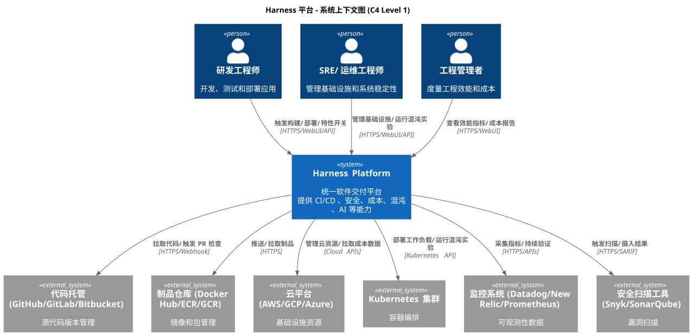</a>
  <figcaption>Harness 平台 - 系统上下文图 (C4 Level 1) · <a href="/assets/diagrams/articles/2026-04-09-harness-platform-deep-dive-01.svg" target="_blank" rel="noopener">查看原图</a> · <a href="/assets/diagrams/articles/2026-04-09-harness-platform-deep-dive-01.puml" download>图表源文件</a></figcaption>
</figure>
### 2.2 平台模块全景图

Harness 平台包含 17+ 个模块，按功能域分为六大类：

<figure>
  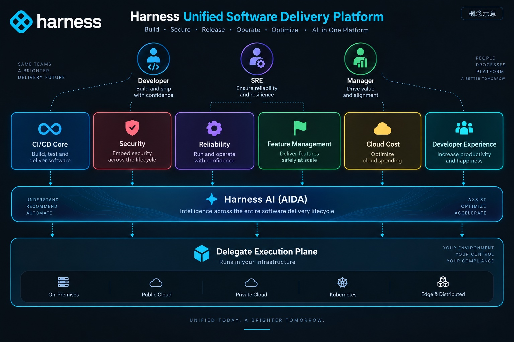
  <figcaption>统一交付平台架构 · AI 生成概念示意</figcaption>
</figure>

<figure class="article-diagram">
  <a href="/assets/diagrams/articles/2026-04-09-harness-platform-deep-dive-02.svg" target="_blank" rel="noopener" aria-label="打开原图：流程与关系图"></a>
  <figcaption>流程与关系图 · <a href="/assets/diagrams/articles/2026-04-09-harness-platform-deep-dive-02.svg" target="_blank" rel="noopener">查看原图</a> · <a href="/assets/diagrams/articles/2026-04-09-harness-platform-deep-dive-02.mmd" download>图表源文件</a></figcaption>
</figure>
### 2.3 平台内部容器架构图（C4 Level 2）

<figure class="article-diagram">
  <a href="/assets/diagrams/articles/2026-04-09-harness-platform-deep-dive-03.svg" target="_blank" rel="noopener" aria-label="打开原图：Harness 平台 - 容器架构图 (C4 Level 2)">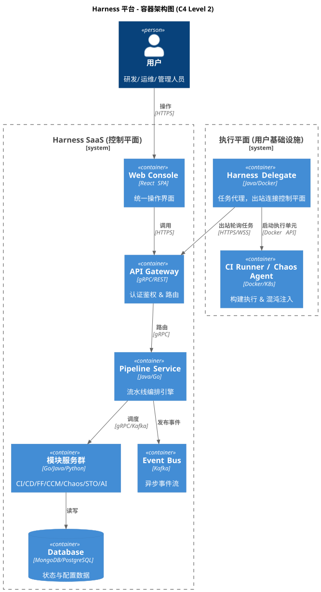</a>
  <figcaption>Harness 平台 - 容器架构图 (C4 Level 2) · <a href="/assets/diagrams/articles/2026-04-09-harness-platform-deep-dive-03.svg" target="_blank" rel="noopener">查看原图</a> · <a href="/assets/diagrams/articles/2026-04-09-harness-platform-deep-dive-03.puml" download>图表源文件</a></figcaption>
</figure>
---

## 3. 核心引擎：Delegate 机制深度解析

Delegate 是 Harness 平台最核心、最具差异化的架构设计。它彻底解决了 SaaS 控制平面与用户私有网络之间的安全连接问题，同时不需要在防火墙上开放入站端口。

### 3.1 官方架构图

下图展示了 Harness CD SaaS 架构中 Delegate 与控制平面、各类外部系统的完整连接关系：

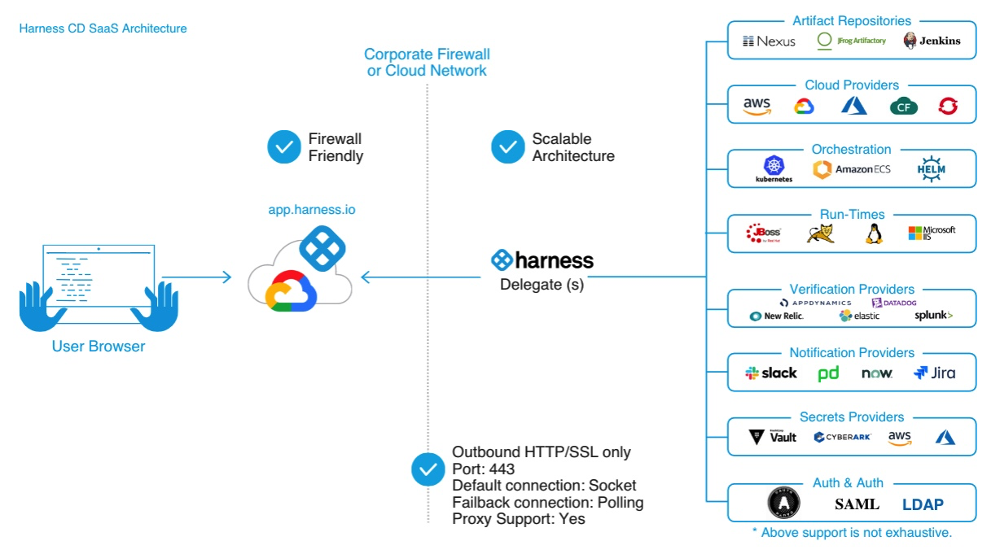

**核心要点**：
- Delegate 只需**出站 HTTPS 443 端口**，无需开放任何入站端口
- 默认使用 **WebSocket 长连接**，备用 **HTTP Polling** 轮询模式
- 支持 Proxy 代理透传

### 3.2 Delegate 通信时序

<figure class="article-diagram">
  <a href="/assets/diagrams/articles/2026-04-09-harness-platform-deep-dive-04.svg" target="_blank" rel="noopener" aria-label="打开原图：Harness Delegate 通信时序图">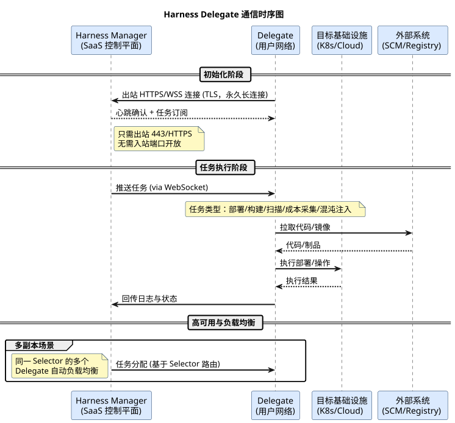</a>
  <figcaption>Harness Delegate 通信时序图 · <a href="/assets/diagrams/articles/2026-04-09-harness-platform-deep-dive-04.svg" target="_blank" rel="noopener">查看原图</a> · <a href="/assets/diagrams/articles/2026-04-09-harness-platform-deep-dive-04.puml" download>图表源文件</a></figcaption>
</figure>
### 3.3 Delegate 选择器与路由机制

<figure class="article-diagram">
  <a href="/assets/diagrams/articles/2026-04-09-harness-platform-deep-dive-05.svg" target="_blank" rel="noopener" aria-label="打开原图：流程与关系图"></a>
  <figcaption>流程与关系图 · <a href="/assets/diagrams/articles/2026-04-09-harness-platform-deep-dive-05.svg" target="_blank" rel="noopener">查看原图</a> · <a href="/assets/diagrams/articles/2026-04-09-harness-platform-deep-dive-05.mmd" download>图表源文件</a></figcaption>
</figure>
### 3.4 Delegate 部署规格参考

| 副本数 | 内存 | CPU | 最大并行任务 | 适用场景 |
|--------|------|-----|------------|---------|
| 1 | 2 GB | 0.5 Core | 10 | 开发/测试环境 |
| 2 | 4 GB | 1 Core | 20 | 小规模生产 |
| 4 | 8 GB | 2 Core | 40 | 中等规模 |
| 8 | 16 GB | 4 Core | 80 | 大规模生产 |

> **CCM 场景**：200 节点 / 4000 Pod 基线需要 2 vCPU + 8 GB，每增加 50 节点需额外 0.5 vCPU + 2 GB 内存。

### 3.5 Delegate 镜像选型

```bash
# 标准镜像：内置 kubectl、Helm、ChartMuseum
harness/delegate:yy.mm.verno

# 精简镜像：无客户端工具，适合自定义扩展
harness/delegate:yy.mm.verno.minimal
```

```dockerfile
FROM harness/delegate:24.04.82601.minimal

RUN apt-get update && apt-get install -y \
    kubectl \
    helm \
    aws-cli \
    your-internal-tool

USER harness
```

---

## 4. CI 模块：智能构建加速三剑客

Harness CI 的核心竞争力在于三项智能加速机制，通过数据驱动的方式系统性缩短构建反馈周期。

### 4.1 Test Intelligence（测试智能选择）

**核心原理**：不运行全量测试，而是通过**调用图（Call Graph）分析**，只执行与变更代码相关的测试子集。

<figure class="article-diagram">
  <a href="/assets/diagrams/articles/2026-04-09-harness-platform-deep-dive-06.svg" target="_blank" rel="noopener" aria-label="打开原图：Test Intelligence 核心工作原理">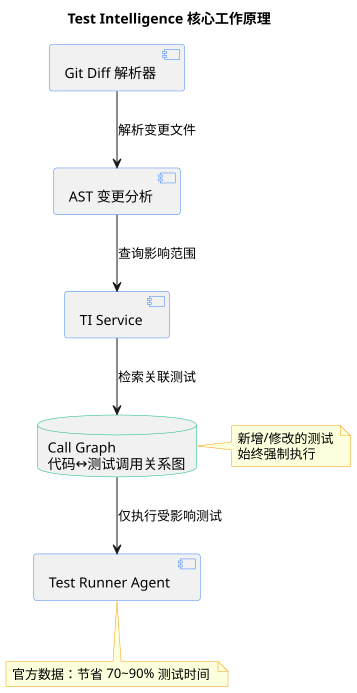</a>
  <figcaption>Test Intelligence 核心工作原理 · <a href="/assets/diagrams/articles/2026-04-09-harness-platform-deep-dive-06.svg" target="_blank" rel="noopener">查看原图</a> · <a href="/assets/diagrams/articles/2026-04-09-harness-platform-deep-dive-06.puml" download>图表源文件</a></figcaption>
</figure>
**TI 支持的语言和框架**：

| 语言 | 测试框架 |
|------|---------|
| Java | JUnit, TestNG, Mockito |
| Kotlin | JUnit |
| Scala | ScalaTest |
| Python | pytest |
| Ruby | RSpec |
| C# | NUnit, MSTest, xUnit |
| JavaScript/TypeScript | Jest, Mocha |
| Go | 原生 go test |

### 4.2 Cache Intelligence（智能缓存）

Cache Intelligence 自动识别构建工具的依赖目录并进行智能缓存，无需手动配置缓存路径。

<figure class="article-diagram">
  <a href="/assets/diagrams/articles/2026-04-09-harness-platform-deep-dive-07.svg" target="_blank" rel="noopener" aria-label="打开原图：流程与关系图">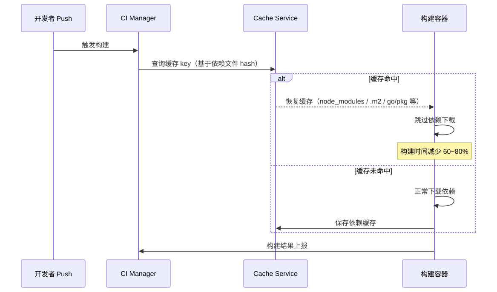</a>
  <figcaption>流程与关系图 · <a href="/assets/diagrams/articles/2026-04-09-harness-platform-deep-dive-07.svg" target="_blank" rel="noopener">查看原图</a> · <a href="/assets/diagrams/articles/2026-04-09-harness-platform-deep-dive-07.mmd" download>图表源文件</a></figcaption>
</figure>
**自动检测的缓存目录**（无需手动配置）：

| 构建工具 | 缓存路径 |
|---------|---------|
| Maven | `~/.m2` |
| Gradle | `~/.gradle` |
| npm | `node_modules`, `~/.npm` |
| yarn | `.yarn/cache` |
| pip | `~/.cache/pip` |
| Go | `~/go/pkg/mod` |
| Ruby | `~/.bundle/cache` |

### 4.3 Build Intelligence（构建智能加速）

Build Intelligence 通过**远程缓存（Remote Caching）**和**增量构建（Incremental Build）**，实现仅重新构建真正发生变化的部分。

<figure class="article-diagram">
  <a href="/assets/diagrams/articles/2026-04-09-harness-platform-deep-dive-08.svg" target="_blank" rel="noopener" aria-label="打开原图：流程与关系图"></a>
  <figcaption>流程与关系图 · <a href="/assets/diagrams/articles/2026-04-09-harness-platform-deep-dive-08.svg" target="_blank" rel="noopener">查看原图</a> · <a href="/assets/diagrams/articles/2026-04-09-harness-platform-deep-dive-08.mmd" download>图表源文件</a></figcaption>
</figure>
**支持的构建系统**：Bazel、Gradle、Maven（通过 Develocity 集成）

<figure>
  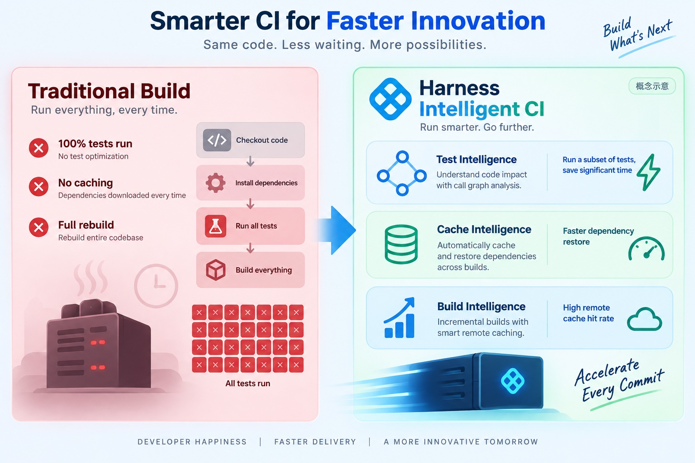
  <figcaption>CI 智能加速 · AI 生成概念示意</figcaption>
</figure>

### 4.4 CI Pipeline YAML 示例

```yaml
pipeline:
  name: "智能构建示例"
  stages:
    - stage:
        name: Build & Test
        type: CI
        spec:
          cloneCodebase: true
          caching:
            enabled: true
          execution:
            steps:
              - step:
                  type: RunTests
                  name: Run Smart Tests
                  spec:
                    language: Java
                    buildTool: Maven
                    args: test
                    runOnlySelectedTests: true
                    enableTestSplitting: true
                    testSplitStrategy: TimeBased
```

---

## 5. CD & GitOps：多策略部署体系

### 5.1 部署策略全景

<figure class="article-diagram">
  <a href="/assets/diagrams/articles/2026-04-09-harness-platform-deep-dive-09.svg" target="_blank" rel="noopener" aria-label="打开原图：流程与关系图"></a>
  <figcaption>流程与关系图 · <a href="/assets/diagrams/articles/2026-04-09-harness-platform-deep-dive-09.svg" target="_blank" rel="noopener">查看原图</a> · <a href="/assets/diagrams/articles/2026-04-09-harness-platform-deep-dive-09.mmd" download>图表源文件</a></figcaption>
</figure>
### 5.2 金丝雀部署 + 持续验证架构

这是 Harness CD 最核心的差异化能力之一：将**监控数据**与**部署决策**直接整合。

<figure>
  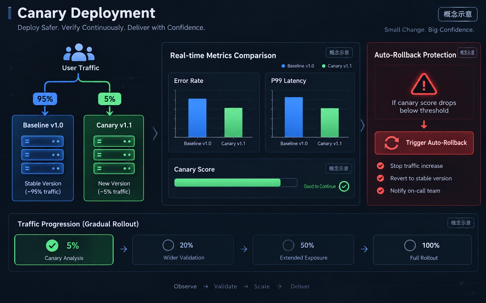
  <figcaption>金丝雀发布与回滚 · AI 生成概念示意</figcaption>
</figure>

<figure class="article-diagram">
  <a href="/assets/diagrams/articles/2026-04-09-harness-platform-deep-dive-10.svg" target="_blank" rel="noopener" aria-label="打开原图：金丝雀部署 + 持续验证（CV）完整流程">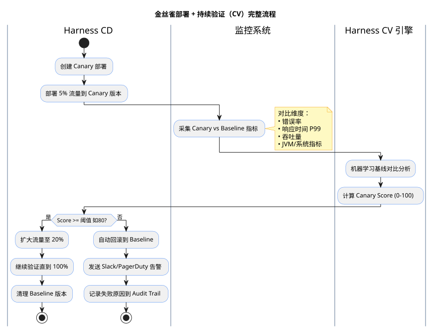</a>
  <figcaption>金丝雀部署 + 持续验证（CV）完整流程 · <a href="/assets/diagrams/articles/2026-04-09-harness-platform-deep-dive-10.svg" target="_blank" rel="noopener">查看原图</a> · <a href="/assets/diagrams/articles/2026-04-09-harness-platform-deep-dive-10.puml" download>图表源文件</a></figcaption>
</figure>
### 5.3 GitOps 架构模型

Harness GitOps 基于 **Argo CD 内核**构建，在其之上增加了企业级多集群管理、RBAC 和审计能力。

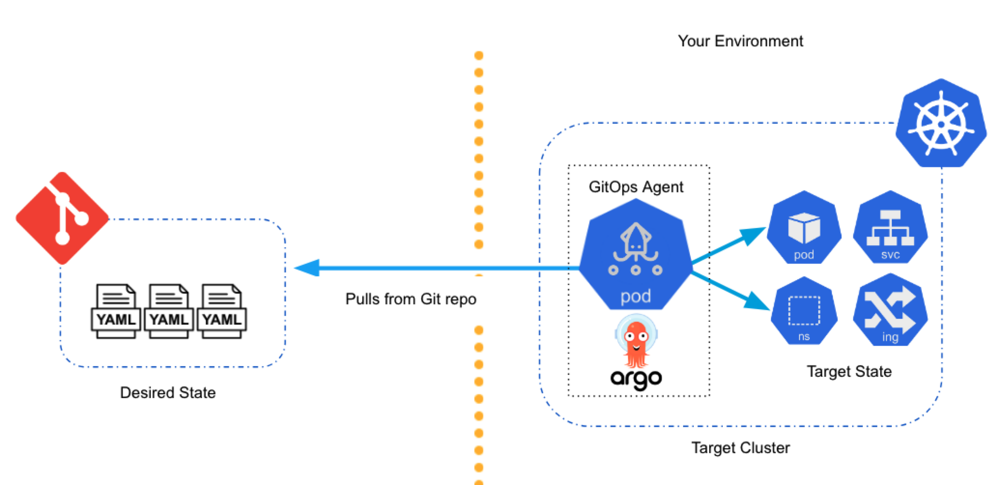

**关键设计原则**：
- Git 仓库是唯一的**真实来源（Source of Truth）**
- GitOps Agent 运行在目标集群内，**出站**连接控制平面
- 支持**离线降级**：控制平面不可达时，Agent 继续维持已知期望状态
- 通过 **PR Pipeline** 实现多环境渐进式自动推进

<figure class="article-diagram">
  <a href="/assets/diagrams/articles/2026-04-09-harness-platform-deep-dive-11.svg" target="_blank" rel="noopener" aria-label="打开原图：Harness GitOps 多集群管理架构">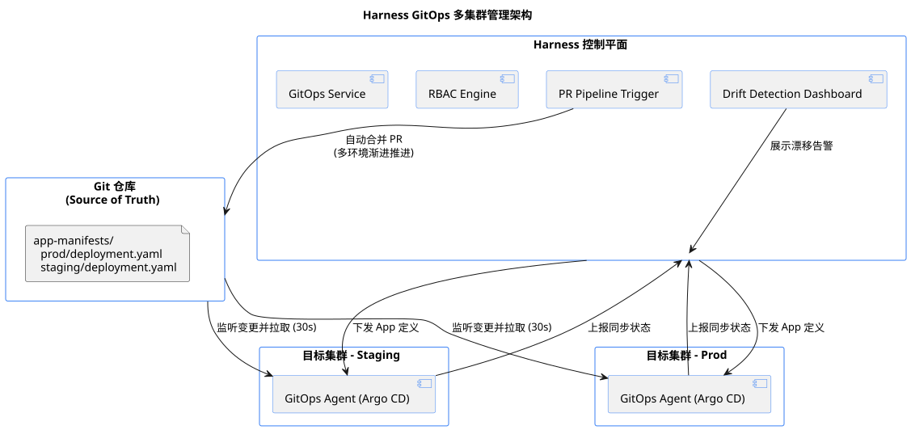</a>
  <figcaption>Harness GitOps 多集群管理架构 · <a href="/assets/diagrams/articles/2026-04-09-harness-platform-deep-dive-11.svg" target="_blank" rel="noopener">查看原图</a> · <a href="/assets/diagrams/articles/2026-04-09-harness-platform-deep-dive-11.puml" download>图表源文件</a></figcaption>
</figure>
### 5.4 IaCM：基础设施即代码管理

<figure class="article-diagram">
  <a href="/assets/diagrams/articles/2026-04-09-harness-platform-deep-dive-12.svg" target="_blank" rel="noopener" aria-label="打开原图：流程与关系图"></a>
  <figcaption>流程与关系图 · <a href="/assets/diagrams/articles/2026-04-09-harness-platform-deep-dive-12.svg" target="_blank" rel="noopener">查看原图</a> · <a href="/assets/diagrams/articles/2026-04-09-harness-platform-deep-dive-12.mmd" download>图表源文件</a></figcaption>
</figure>
---

## 6. Feature Management & Experimentation

Harness FME（Feature Management & Experimentation）整合了原 Split.io 的能力，为研发团队提供从**功能发布控制**到**A/B 实验分析**的完整闭环。

### 6.1 Feature Flag 评估引擎架构

<figure class="article-diagram">
  <a href="/assets/diagrams/articles/2026-04-09-harness-platform-deep-dive-13.svg" target="_blank" rel="noopener" aria-label="打开原图：Feature Flag 本地评估引擎流程">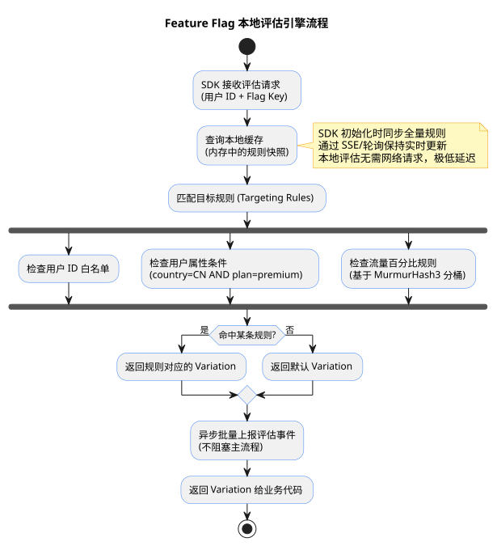</a>
  <figcaption>Feature Flag 本地评估引擎流程 · <a href="/assets/diagrams/articles/2026-04-09-harness-platform-deep-dive-13.svg" target="_blank" rel="noopener">查看原图</a> · <a href="/assets/diagrams/articles/2026-04-09-harness-platform-deep-dive-13.puml" download>图表源文件</a></figcaption>
</figure>
### 6.2 渐进式功能发布时间轴

<figure class="article-diagram">
  <a href="/assets/diagrams/articles/2026-04-09-harness-platform-deep-dive-14.svg" target="_blank" rel="noopener" aria-label="打开原图：功能渐进式发布计划">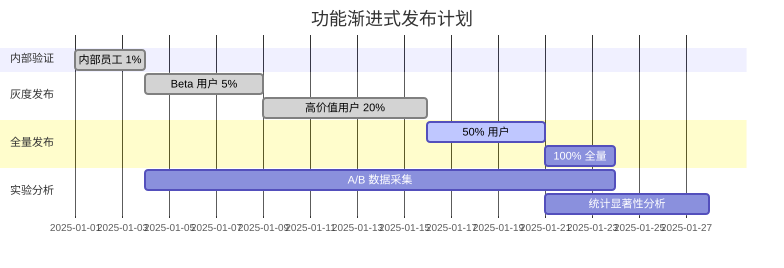</a>
  <figcaption>功能渐进式发布计划 · <a href="/assets/diagrams/articles/2026-04-09-harness-platform-deep-dive-14.svg" target="_blank" rel="noopener">查看原图</a> · <a href="/assets/diagrams/articles/2026-04-09-harness-platform-deep-dive-14.mmd" download>图表源文件</a></figcaption>
</figure>
### 6.3 多语言 SDK 接入示例

```java
SplitClient client = SplitClientFactory.build(apiKey, config);

String treatment = client.getTreatment(
    userId,
    "new-checkout-flow",
    ImmutableMap.of(
        "country", "CN",
        "plan", "premium"
    )
);

if ("on".equals(treatment)) {
    // 新结账流程
} else {
    // 旧结账流程
}
```

### 6.4 实验统计显著性示例

```
指标：转化率
Control 组：N=50,000，转化率=3.2%
Treatment 组：N=50,000，转化率=3.7%
提升幅度：+15.6%
p-value：0.003 (< 0.05，统计显著)
95% 置信区间：[+8.1%, +23.2%]
结论：✅ 新特性对转化率有显著正向影响，建议全量发布
```

### 6.5 FME 2025 新特性：云断线容灾

> **2025 重大更新**：Harness FME 引入 Relay Proxy 离线降级机制。当云服务宕机时，SDK 继续基于本地缓存的规则快照进行评估，不会退化为默认值，确保功能开关在云故障期间依然稳定运行。

---

## 7. 平台安全：STO 安全测试编排

### 7.1 DevSecOps 集成架构

Harness STO 的核心理念是**将安全扫描嵌入 CI/CD 流水线的每个阶段**，而非将其作为独立的门控步骤。

<figure class="article-diagram">
  <a href="/assets/diagrams/articles/2026-04-09-harness-platform-deep-dive-15.svg" target="_blank" rel="noopener" aria-label="打开原图：STO DevSecOps 安全扫描编排架构">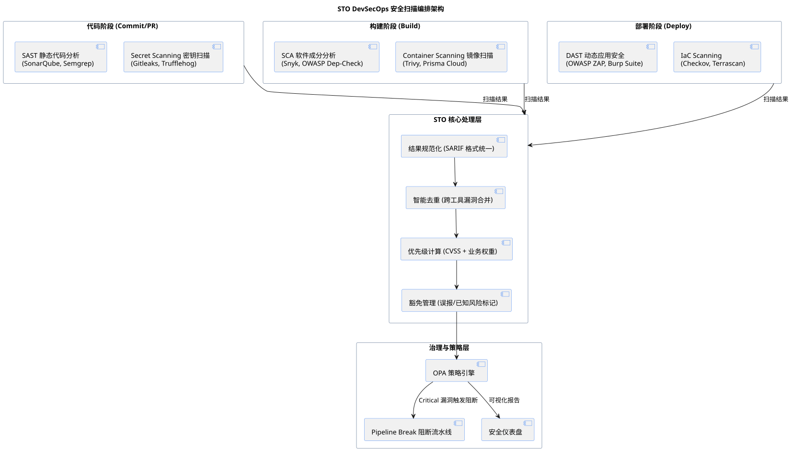</a>
  <figcaption>STO DevSecOps 安全扫描编排架构 · <a href="/assets/diagrams/articles/2026-04-09-harness-platform-deep-dive-15.svg" target="_blank" rel="noopener">查看原图</a> · <a href="/assets/diagrams/articles/2026-04-09-harness-platform-deep-dive-15.puml" download>图表源文件</a></figcaption>
</figure>
### 7.2 三种扫描模式对比

| 模式 | 工作方式 | 适用场景 |
|------|---------|---------|
| **Orchestration（编排）** | Harness 自动触发扫描器并摄入结果 | 新接入场景，零配置 |
| **Extraction（提取）** | 从已有的扫描器实例拉取结果 | 已有扫描基础设施 |
| **Ingestion（摄入）** | 摄入外部任意来源的 SARIF 文件 | 离线/自定义扫描器 |

### 7.3 软件供应链安全（SCS）

<figure class="article-diagram">
  <a href="/assets/diagrams/articles/2026-04-09-harness-platform-deep-dive-16.svg" target="_blank" rel="noopener" aria-label="打开原图：流程与关系图"></a>
  <figcaption>流程与关系图 · <a href="/assets/diagrams/articles/2026-04-09-harness-platform-deep-dive-16.svg" target="_blank" rel="noopener">查看原图</a> · <a href="/assets/diagrams/articles/2026-04-09-harness-platform-deep-dive-16.mmd" download>图表源文件</a></figcaption>
</figure>
---

## 8. 云成本管理 CCM：FinOps 工程化

### 8.1 CCM 数据流架构

<figure class="article-diagram">
  <a href="/assets/diagrams/articles/2026-04-09-harness-platform-deep-dive-17.svg" target="_blank" rel="noopener" aria-label="打开原图：CCM 云成本管理数据流（核心）">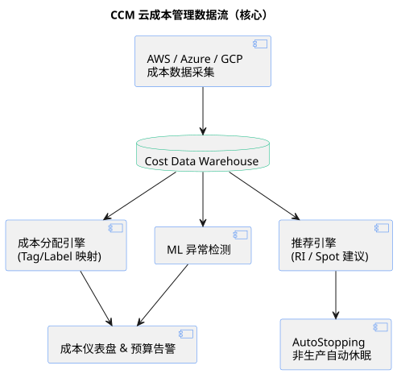</a>
  <figcaption>CCM 云成本管理数据流（核心） · <a href="/assets/diagrams/articles/2026-04-09-harness-platform-deep-dive-17.svg" target="_blank" rel="noopener">查看原图</a> · <a href="/assets/diagrams/articles/2026-04-09-harness-platform-deep-dive-17.puml" download>图表源文件</a></figcaption>
</figure>
### 8.2 AutoStopping 工作原理

AutoStopping 在检测到流量空闲后，自动将非生产资源缩容为零，有新流量时自动唤醒。

<figure>
  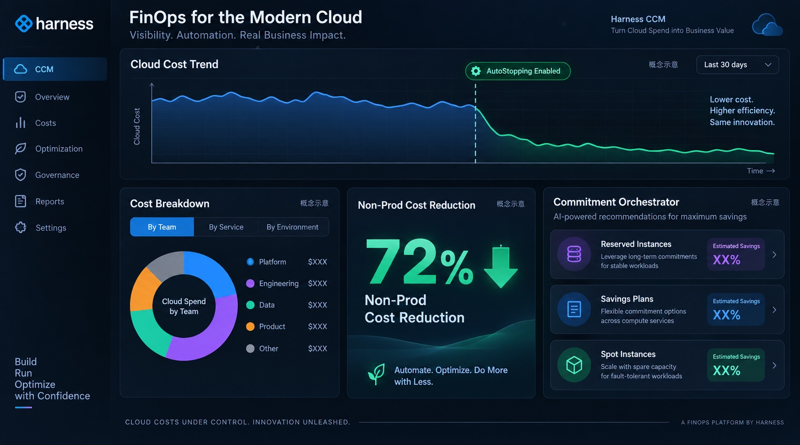
  <figcaption>云成本管理 · AI 生成概念示意</figcaption>
</figure>

<figure class="article-diagram">
  <a href="/assets/diagrams/articles/2026-04-09-harness-platform-deep-dive-18.svg" target="_blank" rel="noopener" aria-label="打开原图：流程与关系图">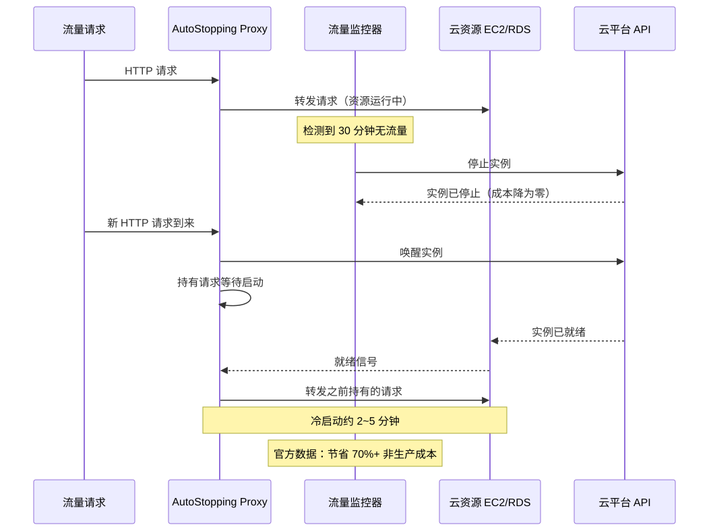</a>
  <figcaption>流程与关系图 · <a href="/assets/diagrams/articles/2026-04-09-harness-platform-deep-dive-18.svg" target="_blank" rel="noopener">查看原图</a> · <a href="/assets/diagrams/articles/2026-04-09-harness-platform-deep-dive-18.mmd" download>图表源文件</a></figcaption>
</figure>
### 8.3 Commitment Orchestrator（2025 重点新特性）

<figure class="article-diagram">
  <a href="/assets/diagrams/articles/2026-04-09-harness-platform-deep-dive-19.svg" target="_blank" rel="noopener" aria-label="打开原图：流程与关系图"></a>
  <figcaption>流程与关系图 · <a href="/assets/diagrams/articles/2026-04-09-harness-platform-deep-dive-19.svg" target="_blank" rel="noopener">查看原图</a> · <a href="/assets/diagrams/articles/2026-04-09-harness-platform-deep-dive-19.mmd" download>图表源文件</a></figcaption>
</figure>
---

## 9. 混沌工程：韧性测试闭环

### 9.1 两种执行模式

Harness 混沌工程支持 **Agentless** 和 **Agent** 两种执行模式，适应不同基础设施场景：

**Agentless 模式**（通过 Harness Delegate 执行）：

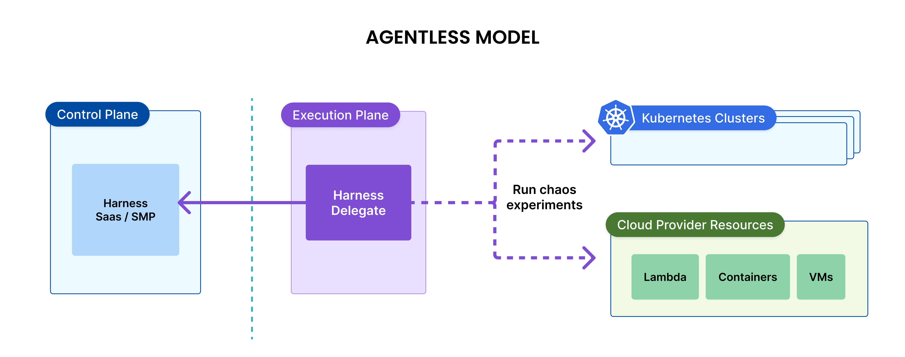

**Agent 模式**（在目标资源上直接部署 Chaos Agent）：

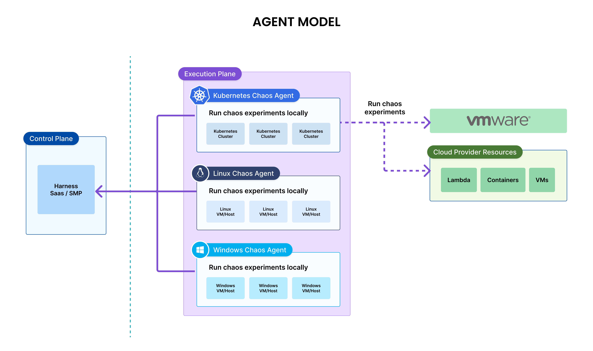

**SaaS vs SMP 完整部署对比**：


### 9.2 混沌工程控制平面架构

<figure class="article-diagram">
  <a href="/assets/diagrams/articles/2026-04-09-harness-platform-deep-dive-20.svg" target="_blank" rel="noopener" aria-label="打开原图：Harness 混沌工程控制平面架构">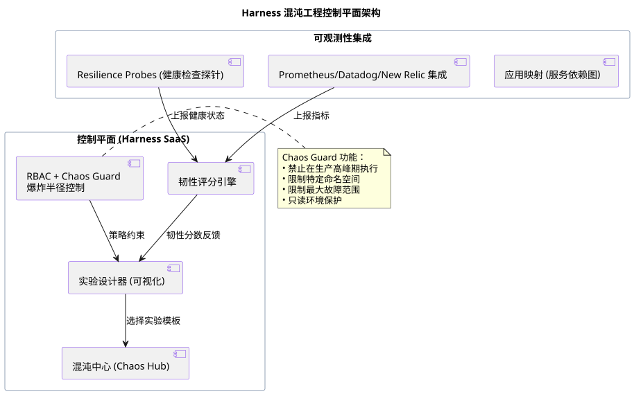</a>
  <figcaption>Harness 混沌工程控制平面架构 · <a href="/assets/diagrams/articles/2026-04-09-harness-platform-deep-dive-20.svg" target="_blank" rel="noopener">查看原图</a> · <a href="/assets/diagrams/articles/2026-04-09-harness-platform-deep-dive-20.puml" download>图表源文件</a></figcaption>
</figure>
### 9.3 韧性覆盖率矩阵

<figure class="article-diagram">
  <a href="/assets/diagrams/articles/2026-04-09-harness-platform-deep-dive-21.svg" target="_blank" rel="noopener" aria-label="打开原图：Service Resilience Coverage Matrix">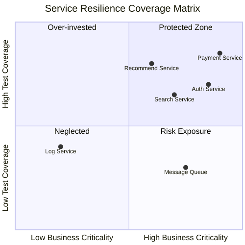</a>
  <figcaption>Service Resilience Coverage Matrix · <a href="/assets/diagrams/articles/2026-04-09-harness-platform-deep-dive-21.svg" target="_blank" rel="noopener">查看原图</a> · <a href="/assets/diagrams/articles/2026-04-09-harness-platform-deep-dive-21.mmd" download>图表源文件</a></figcaption>
</figure>
### 9.4 常见混沌实验类型

| 故障类型 | 实验场景 | 验证目标 |
|---------|---------|---------|
| **Pod Kill** | 随机杀死 Pod | 重启恢复能力，K8s 自愈机制 |
| **CPU Hog** | 注入 CPU 压力 | 资源隔离，限流熔断 |
| **Memory Hog** | 注入内存压力 | OOM 处理，Pod 驱逐策略 |
| **Network Latency** | 注入网络延迟 | 超时设置，熔断器触发 |
| **Network Partition** | 模拟网络分区 | 服务降级，数据一致性 |
| **Node Drain** | 驱逐节点 | 多副本分布，PDB 配置 |
| **AWS AZ Failure** | 模拟可用区故障 | 跨 AZ 高可用 |
| **RDS Failover** | 触发数据库主从切换 | 连接池重试，写入幂等性 |

---

## 10. AI 原生能力：AIDA & Agents

Harness AI 在 2025-2026 年进行了系统性升级，从功能性 AI 辅助工具演进为 **AI-Native DevOps 平台**。

### 10.1 AI Agent 体系架构

<figure class="article-diagram">
  <a href="/assets/diagrams/articles/2026-04-09-harness-platform-deep-dive-22.svg" target="_blank" rel="noopener" aria-label="打开原图：Harness AI Agent 架构（2025）">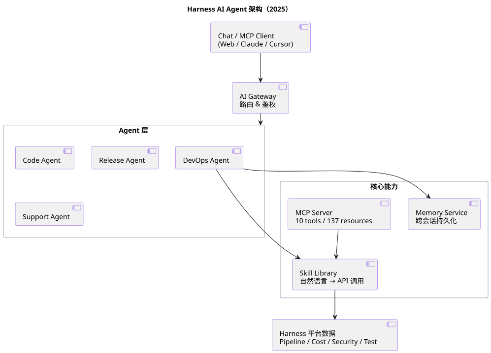</a>
  <figcaption>Harness AI Agent 架构（2025） · <a href="/assets/diagrams/articles/2026-04-09-harness-platform-deep-dive-22.svg" target="_blank" rel="noopener">查看原图</a> · <a href="/assets/diagrams/articles/2026-04-09-harness-platform-deep-dive-22.puml" download>图表源文件</a></figcaption>
</figure>
### 10.2 AI 能力矩阵（2025-2026）

| 能力域 | 功能 | 技术实现 |
|--------|------|---------|
| **流水线生成** | 自然语言描述 → Pipeline YAML | LLM + 平台知识库 RAG |
| **故障根因分析** | 构建/部署失败自动定位 + 修复建议 | 日志分析 + 错误模式匹配 |
| **PR 代码审查** | 自动生成 PR 摘要，识别风险变更 | Diff 分析 + 代码语义理解 |
| **成本优化建议** | 自然语言查询云成本 + 优化方案 | CCM 数据 + 推荐模型 |
| **安全漏洞修复** | CVE 扫描结果自动生成修复代码 | STO 数据 + CodeGen |
| **Feature Flag 管理** | 自然语言创建/修改/发布标志 | Release Agent + FME API |
| **混沌实验推荐** | 基于服务拓扑推荐实验方案 | 服务映射 + 实验知识库 |
| **持久化记忆** | 跨会话保留用户偏好和上下文 | Memory Service（向量存储） |

### 10.3 MCP Server 集成（2025 重大更新）

Harness 发布了官方 MCP Server，允许 Claude、Cursor、GitHub Copilot 等 AI 工具直接操作 Harness 平台：

<figure class="article-diagram">
  <a href="/assets/diagrams/articles/2026-04-09-harness-platform-deep-dive-23.svg" target="_blank" rel="noopener" aria-label="打开原图：流程与关系图"></a>
  <figcaption>流程与关系图 · <a href="/assets/diagrams/articles/2026-04-09-harness-platform-deep-dive-23.svg" target="_blank" rel="noopener">查看原图</a> · <a href="/assets/diagrams/articles/2026-04-09-harness-platform-deep-dive-23.mmd" download>图表源文件</a></figcaption>
</figure>
**典型使用场景**：

```
用户："帮我检查 payment-service 最近 3 次部署失败的根因，
       并生成修复后的 pipeline YAML"

AI Agent 调用 MCP Server：
  1. get_pipeline_executions(service="payment-service", limit=3)
  2. get_execution_logs(execution_id=xxx, filter="error")
  3. analyze_failure_patterns(logs=...)
  4. generate_pipeline_yaml(fixes=...)
```

<figure>
  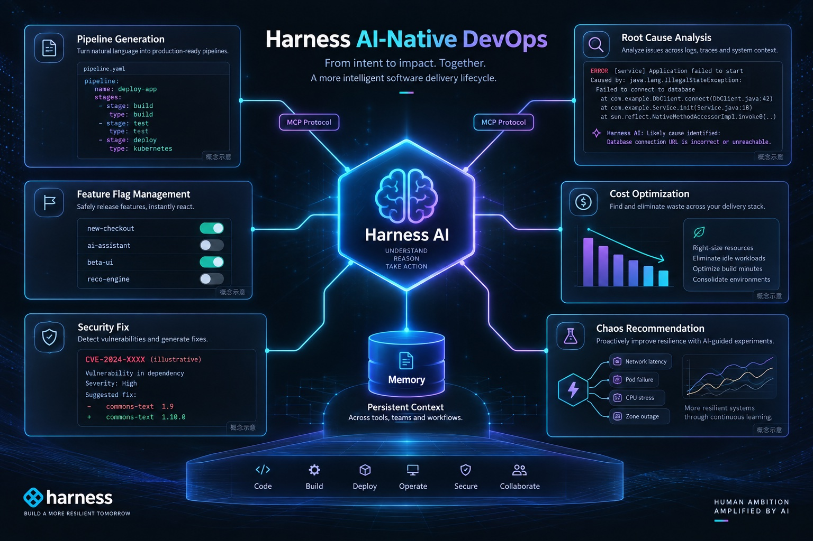
  <figcaption>AI 与 DevOps · AI 生成概念示意</figcaption>
</figure>

---

## 11. 内部开发者门户 IDP

### 11.1 IDP 架构设计

IDP 基于 **Backstage 框架**构建，提供企业级开发者体验管理：

<figure class="article-diagram">
  <a href="/assets/diagrams/articles/2026-04-09-harness-platform-deep-dive-24.svg" target="_blank" rel="noopener" aria-label="打开原图：Harness IDP 架构图（基于 Backstage）">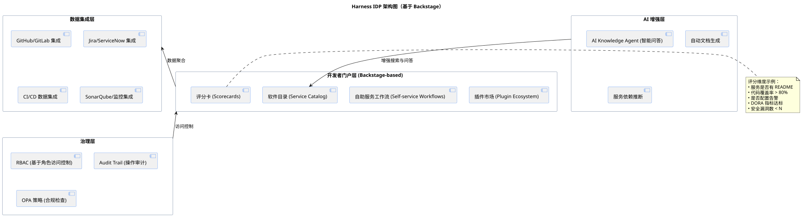</a>
  <figcaption>Harness IDP 架构图（基于 Backstage） · <a href="/assets/diagrams/articles/2026-04-09-harness-platform-deep-dive-24.svg" target="_blank" rel="noopener">查看原图</a> · <a href="/assets/diagrams/articles/2026-04-09-harness-platform-deep-dive-24.puml" download>图表源文件</a></figcaption>
</figure>
### 11.2 自助服务工作流示例

```yaml
apiVersion: scaffolder.backstage.io/v1beta3
kind: Template
metadata:
  name: create-microservice
  title: 创建新微服务
spec:
  parameters:
    - title: 服务基本信息
      properties:
        serviceName:
          title: 服务名称
          type: string
        language:
          title: 开发语言
          type: string
          enum: [Java, Go, Python, Node.js]
  steps:
    - id: create-repo
      action: publish:github
      input:
        repoUrl: github.com/org/${{ parameters.serviceName }}
    - id: create-ci-pipeline
      action: harness:pipeline:create
      input:
        template: microservice-ci-template
    - id: register-catalog
      action: catalog:register
      input:
        catalogInfoPath: catalog-info.yaml
```

---

## 12. 工程效能度量 SEI

### 12.1 DORA 四项核心指标

Harness SEI 原生支持 DORA 四项核心指标的自动化采集与计算：

<figure class="article-diagram">
  <a href="/assets/diagrams/articles/2026-04-09-harness-platform-deep-dive-25.svg" target="_blank" rel="noopener" aria-label="打开原图：流程与关系图"></a>
  <figcaption>流程与关系图 · <a href="/assets/diagrams/articles/2026-04-09-harness-platform-deep-dive-25.svg" target="_blank" rel="noopener">查看原图</a> · <a href="/assets/diagrams/articles/2026-04-09-harness-platform-deep-dive-25.mmd" download>图表源文件</a></figcaption>
</figure>
### 12.2 工程效能度量全景

<figure class="article-diagram">
  <a href="/assets/diagrams/articles/2026-04-09-harness-platform-deep-dive-26.svg" target="_blank" rel="noopener" aria-label="打开原图：SEI 工程效能度量体系">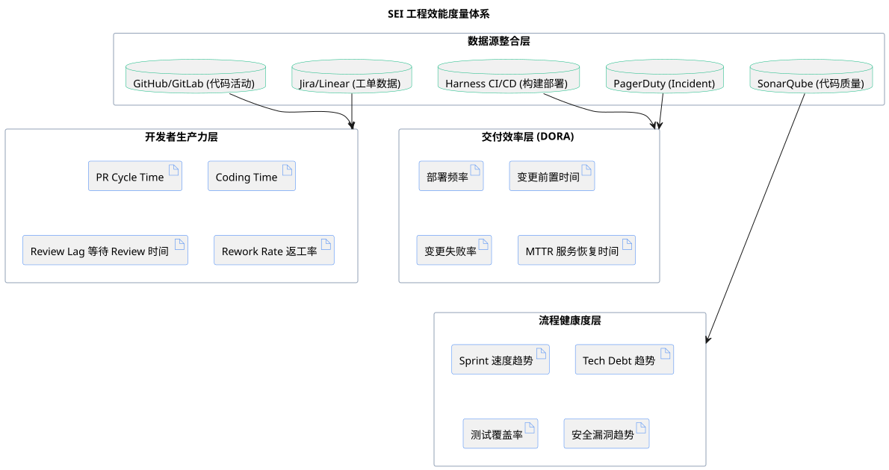</a>
  <figcaption>SEI 工程效能度量体系 · <a href="/assets/diagrams/articles/2026-04-09-harness-platform-deep-dive-26.svg" target="_blank" rel="noopener">查看原图</a> · <a href="/assets/diagrams/articles/2026-04-09-harness-platform-deep-dive-26.puml" download>图表源文件</a></figcaption>
</figure>
### 12.3 Trellis Score（开发者效能综合评分）

| 维度 | 权重 | 度量指标 |
|------|------|---------|
| **代码质量** | 20% | 代码复杂度、重复率、测试覆盖率 |
| **代码量** | 15% | 有效代码行数（排除注释/空行） |
| **速度** | 25% | PR 周期时间、发布频率 |
| **影响力** | 20% | PR 被引用次数、代码存活率 |
| **职业成长** | 10% | 新技术栈涉猎、跨组件贡献 |
| **协作** | 10% | Review 参与度、反馈质量 |

---

## 13. 全平台技术演进路线图

### 13.1 Harness 平台发展历程

<figure class="article-diagram">
  <a href="/assets/diagrams/articles/2026-04-09-harness-platform-deep-dive-27.svg" target="_blank" rel="noopener" aria-label="打开原图：Harness 平台关键里程碑">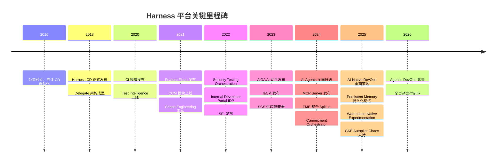</a>
  <figcaption>Harness 平台关键里程碑 · <a href="/assets/diagrams/articles/2026-04-09-harness-platform-deep-dive-27.svg" target="_blank" rel="noopener">查看原图</a> · <a href="/assets/diagrams/articles/2026-04-09-harness-platform-deep-dive-27.mmd" download>图表源文件</a></figcaption>
</figure>
### 13.2 AI 能力演进路线图

<figure class="article-diagram">
  <a href="/assets/diagrams/articles/2026-04-09-harness-platform-deep-dive-28.svg" target="_blank" rel="noopener" aria-label="打开原图：Harness AI 能力演进路线图 2023-2026">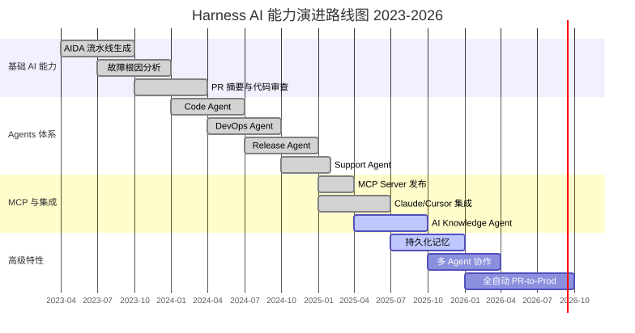</a>
  <figcaption>Harness AI 能力演进路线图 2023-2026 · <a href="/assets/diagrams/articles/2026-04-09-harness-platform-deep-dive-28.svg" target="_blank" rel="noopener">查看原图</a> · <a href="/assets/diagrams/articles/2026-04-09-harness-platform-deep-dive-28.mmd" download>图表源文件</a></figcaption>
</figure>
### 13.3 平台技术栈演进

<figure class="article-diagram">
  <a href="/assets/diagrams/articles/2026-04-09-harness-platform-deep-dive-29.svg" target="_blank" rel="noopener" aria-label="打开原图：流程与关系图"></a>
  <figcaption>流程与关系图 · <a href="/assets/diagrams/articles/2026-04-09-harness-platform-deep-dive-29.svg" target="_blank" rel="noopener">查看原图</a> · <a href="/assets/diagrams/articles/2026-04-09-harness-platform-deep-dive-29.mmd" download>图表源文件</a></figcaption>
</figure>
---

## 14. 竞品技术对比分析

### 14.1 CI/CD 工具全景对比

<figure class="article-diagram">
  <a href="/assets/diagrams/articles/2026-04-09-harness-platform-deep-dive-30.svg" target="_blank" rel="noopener" aria-label="打开原图：CI/CD Tool Comparison: Features vs Operational Complexity">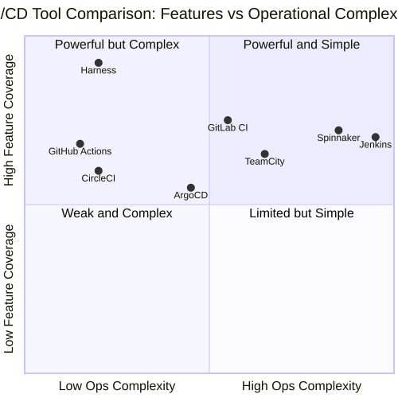</a>
  <figcaption>CI/CD Tool Comparison: Features vs Operational Complexity · <a href="/assets/diagrams/articles/2026-04-09-harness-platform-deep-dive-30.svg" target="_blank" rel="noopener">查看原图</a> · <a href="/assets/diagrams/articles/2026-04-09-harness-platform-deep-dive-30.mmd" download>图表源文件</a></figcaption>
</figure>
### 14.2 核心能力维度对比

| 能力维度 | Harness | GitHub Actions | GitLab CI | Jenkins | Spinnaker |
|---------|---------|---------------|-----------|---------|-----------|
| **CI 构建** | ✅ 原生 + TI/BI/CI | ✅ 生态丰富 | ✅ 原生集成 | ✅ 插件丰富 | ❌ 不含 |
| **CD 多策略** | ✅ 原生蓝绿/金丝雀 | ⚠️ 需第三方 | ⚠️ 基础支持 | ⚠️ 插件依赖 | ✅ 原生支持 |
| **GitOps** | ✅ 基于 Argo CD | ⚠️ 需扩展 | ✅ Flux 集成 | ❌ 需插件 | ❌ |
| **Feature Flags** | ✅ FME 原生 | ❌ | ❌ | ❌ | ❌ |
| **混沌工程** | ✅ 原生 | ❌ | ❌ | ❌ | ❌ |
| **云成本管理** | ✅ CCM 原生 | ❌ | ❌ | ❌ | ❌ |
| **安全扫描编排** | ✅ STO 原生 | ⚠️ 第三方集成 | ✅ 原生扫描 | ⚠️ 插件 | ❌ |
| **AI 辅助** | ✅ AIDA+Agents | ✅ Copilot | ⚠️ 有限 | ❌ | ❌ |
| **IDP** | ✅ 原生 | ❌ | ❌ | ❌ | ❌ |
| **工程效能度量** | ✅ SEI 原生 | ⚠️ Insights 基础 | ✅ Analytics | ❌ | ❌ |
| **SaaS 托管** | ✅ | ✅ | ✅ | ❌ | ⚠️ |
| **自托管支持** | ✅ | ✅ | ✅ | ✅ | ✅ |
| **学习曲线** | 中等 | 低 | 中等 | 高 | 高 |

### 14.3 选型决策树

<figure class="article-diagram">
  <a href="/assets/diagrams/articles/2026-04-09-harness-platform-deep-dive-31.svg" target="_blank" rel="noopener" aria-label="打开原图：流程与关系图"></a>
  <figcaption>流程与关系图 · <a href="/assets/diagrams/articles/2026-04-09-harness-platform-deep-dive-31.svg" target="_blank" rel="noopener">查看原图</a> · <a href="/assets/diagrams/articles/2026-04-09-harness-platform-deep-dive-31.mmd" download>图表源文件</a></figcaption>
</figure>
---

## 15. 工程落地最佳实践

### 15.1 渐进式迁移策略

<figure class="article-diagram">
  <a href="/assets/diagrams/articles/2026-04-09-harness-platform-deep-dive-32.svg" target="_blank" rel="noopener" aria-label="打开原图：Harness 渐进式迁移路线图">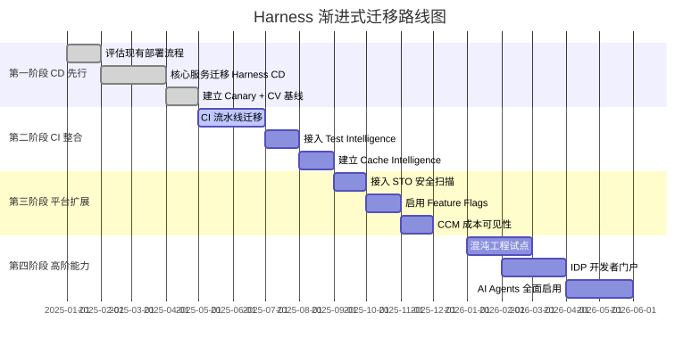</a>
  <figcaption>Harness 渐进式迁移路线图 · <a href="/assets/diagrams/articles/2026-04-09-harness-platform-deep-dive-32.svg" target="_blank" rel="noopener">查看原图</a> · <a href="/assets/diagrams/articles/2026-04-09-harness-platform-deep-dive-32.mmd" download>图表源文件</a></figcaption>
</figure>
### 15.2 Delegate 多环境部署最佳实践

<figure class="article-diagram">
  <a href="/assets/diagrams/articles/2026-04-09-harness-platform-deep-dive-33.svg" target="_blank" rel="noopener" aria-label="打开原图：Delegate 多环境部署最佳实践">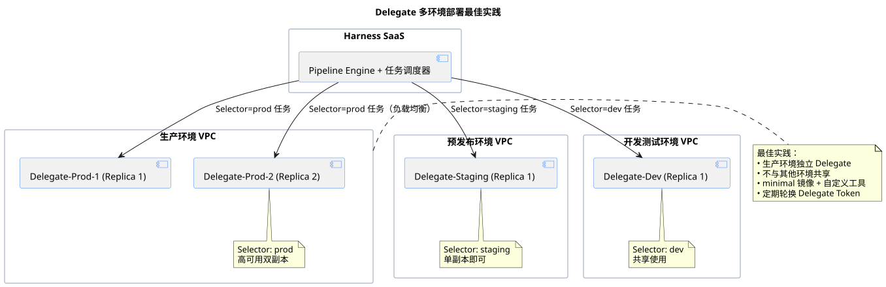</a>
  <figcaption>Delegate 多环境部署最佳实践 · <a href="/assets/diagrams/articles/2026-04-09-harness-platform-deep-dive-33.svg" target="_blank" rel="noopener">查看原图</a> · <a href="/assets/diagrams/articles/2026-04-09-harness-platform-deep-dive-33.puml" download>图表源文件</a></figcaption>
</figure>
### 15.3 Pipeline 治理最佳实践

<figure class="article-diagram">
  <a href="/assets/diagrams/articles/2026-04-09-harness-platform-deep-dive-34.svg" target="_blank" rel="noopener" aria-label="打开原图：流程与关系图"></a>
  <figcaption>流程与关系图 · <a href="/assets/diagrams/articles/2026-04-09-harness-platform-deep-dive-34.svg" target="_blank" rel="noopener">查看原图</a> · <a href="/assets/diagrams/articles/2026-04-09-harness-platform-deep-dive-34.mmd" download>图表源文件</a></figcaption>
</figure>
### 15.4 关键成功指标（KSI）

| 指标类别 | 度量项 | 目标基准 | 度量工具 |
|---------|--------|---------|---------|
| **交付效率** | 部署频率 | 提升 3x+ | SEI DORA |
| **交付效率** | 前置时间 | 减少 50%+ | SEI DORA |
| **稳定性** | 变更失败率 | 降低至 < 5% | SEI DORA |
| **稳定性** | MTTR | 减少 60%+ | SEI DORA |
| **构建效率** | 平均构建时间 | 减少 50~70% | CI Dashboard |
| **测试效率** | 测试执行时间 | 减少 70~90% | TI Dashboard |
| **安全** | 漏洞修复周期 | 减少 40%+ | STO Dashboard |
| **成本** | 非生产环境费用 | 减少 40~70% | CCM Dashboard |
| **开发者体验** | 自助服务率 | > 80% | IDP Analytics |

---

## 附录

### A. 核心 API 参考

```bash
curl -X POST \
  'https://app.harness.io/pipeline/api/pipeline/execute/{pipelineIdentifier}' \
  -H 'x-api-key: YOUR_API_TOKEN' \
  -H 'Content-Type: application/json' \
  -d '{
    "inputSetRefs": ["input-set-prod"],
    "stagesExecutionList": []
  }'
```

### B. 资源参考

| 资源 | 链接 |
|------|------|
| 官方开发者文档 | https://developer.harness.io |
| API 参考文档 | https://apidocs.harness.io |
| Harness 社区 | https://community.harness.io |
| GitHub 示例库 | https://github.com/harness-community |
| Harness 大学 | https://university.harness.io |
| 官方博客 | https://www.harness.io/blog |

---

> **免责声明**：本文中涉及的功能特性、性能数据及路线图基于 Harness 官方文档和公开资料，具体数据因环境和配置不同而有所差异。建议在实际选型时参考最新官方文档并进行 POC 验证。

*最后更新：2026 年 4 月 | 技术视角深度解析*

---

> **免责声明**：本文中涉及的功能特性、性能数据及路线图基于 Harness 官方文档和公开资料，具体数据因环境和配置不同而有所差异。建议在实际选型时参考最新官方文档并进行 POC 验证。

*最后更新：2026 年 4 月 | 技术视角深度解析*
