# Harness Engineering：AI Agent 时代的下一个核心工程能力

<figure>
  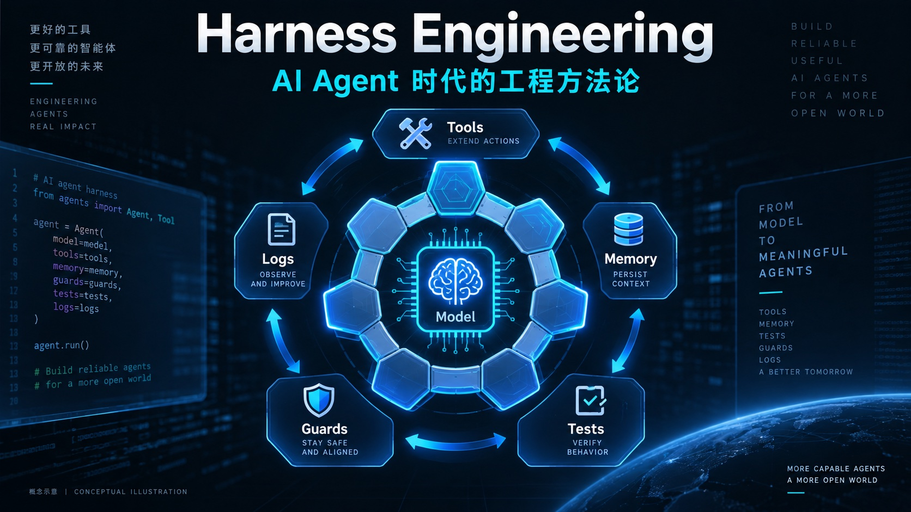
  <figcaption>Harness Engineering · AI 生成概念示意</figcaption>
</figure>

> **作者注**：2024 年是 Prompt Engineering，2025 年是 Context Engineering，2026 年正在成为 **Harness Engineering** 的元年。本文基于 Martin Fowler、Anthropic、OpenAI 等最新一手资料，系统梳理这一正在重塑研发工程师工作方式的新兴方法论。

---

## 目录

1. [从 Prompt 到 Harness：三次范式跃迁](#1-从-prompt-到-harness三次范式跃迁)
2. [什么是 Harness Engineering](#2-什么是-harness-engineering)
3. [Harness 的核心组成](#3-harness-的核心组成)
4. [前馈与反馈：控制系统视角](#4-前馈与反馈控制系统视角)
5. [Harness 设计模式](#5-harness-设计模式)
6. [生产实践：真实案例解析](#6-生产实践真实案例解析)
7. [Agent = Model + Harness：架构设计](#7-agent--model--harness架构设计)
8. [长任务 Agent：跨 Context Window 的挑战](#8-长任务-agent跨-context-window-的挑战)
9. [Harness Engineering vs Context Engineering](#9-harness-engineering-vs-context-engineering)
10. [工程师的角色转变](#10-工程师的角色转变)
11. [落地路线图](#11-落地路线图)
12. [当前局限与未来方向](#12-当前局限与未来方向)

---

## 1. 从 Prompt 到 Harness：三次范式跃迁

过去三年，围绕 LLM 的工程方法论经历了三次明显的范式演进：

<figure class="article-diagram">
  <a href="/assets/diagrams/articles/2026-04-10-harness-engineering-01.svg" target="_blank" rel="noopener" aria-label="打开原图：AI 工程方法论演进时间线">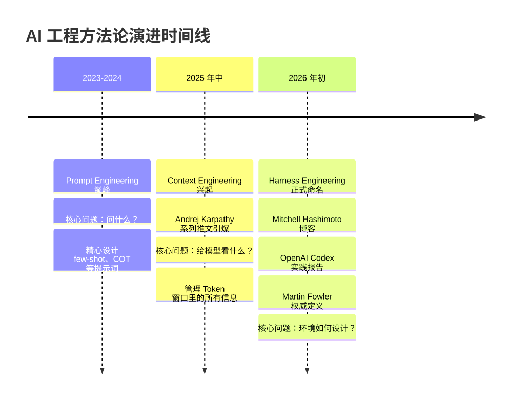</a>
  <figcaption>AI 工程方法论演进时间线 · <a href="/assets/diagrams/articles/2026-04-10-harness-engineering-01.svg" target="_blank" rel="noopener">查看原图</a> · <a href="/assets/diagrams/articles/2026-04-10-harness-engineering-01.mmd" download>图表源文件</a></figcaption>
</figure>
三者是**嵌套关系**，而非替代关系：

```
Harness Engineering  ⊃  Context Engineering  ⊃  Prompt Engineering
     环境设计               信息管理                  指令优化
```

| 层级 | 核心问题 | 工程对象 | 影响范围 |
|------|---------|---------|---------|
| **Prompt Engineering** | 问什么？ | 指令文本 | 单次调用 |
| **Context Engineering** | 展示什么？ | Token 窗口内容 | 单个 Session |
| **Harness Engineering** | 环境如何设计？ | Agent 外部的约束、反馈、工具、运行时 | 整个系统生命周期 |

---

## 2. 什么是 Harness Engineering

### 2.1 核心公式

> **Agent = Model + Harness**

**Harness** 是围绕模型构建的一切基础设施——除了模型本身（权重、推理），其他所有东西都属于 Harness 的范畴。

<figure>
  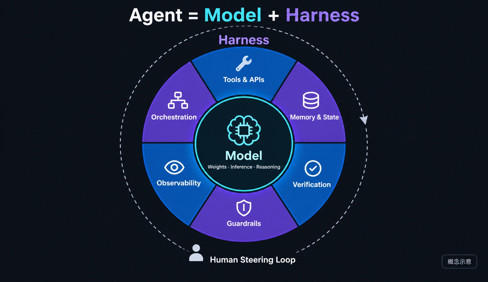
  <figcaption>Model 与 Harness · AI 生成概念示意</figcaption>
</figure>

**Harness Engineering** 则是系统性地设计、构建和演进这套基础设施的工程方法论。

> 来自 Martin Fowler（2026.04.02）：*"Engineering a user harness for a coding agent is a specific form of context engineering — the harness decides when context gets loaded, which tools are available, which actions are allowed, and how failures get handled."*

### 2.2 两个直觉类比

用两个大家熟悉的系统来理解 Model 和 Harness 的关系：

<figure class="article-diagram">
  <a href="/assets/diagrams/articles/2026-04-10-harness-engineering-02.svg" target="_blank" rel="noopener" aria-label="打开原图：流程与关系图"></a>
  <figcaption>流程与关系图 · <a href="/assets/diagrams/articles/2026-04-10-harness-engineering-02.svg" target="_blank" rel="noopener">查看原图</a> · <a href="/assets/diagrams/articles/2026-04-10-harness-engineering-02.mmd" download>图表源文件</a></figcaption>
</figure>
### 2.3 为什么现在成为焦点

随着 Agent 能力的提升，**模型本身已不再是瓶颈**。同一个模型（如 Claude Opus 4.5），在不同 Harness 下的表现可以天差地别：

- LangChain 仅通过改进 Harness，在 Terminal Bench 2.0 排行榜从 30 名外跃升至第 5
- Stripe 每周合并超过 1000 个 AI 生成的 PR，靠的是严格的 CI Harness 而非更好的模型
- OpenAI Codex 团队估算，借助 Harness Engineering，用约 **1/10 的时间**完成了原本需要手写的代码量

> *"The bottleneck was the environment. The agents didn't lack the ability to write code. They lacked structure, tools, feedback, and clear constraints."*

---

## 3. Harness 的核心组成

<figure>
  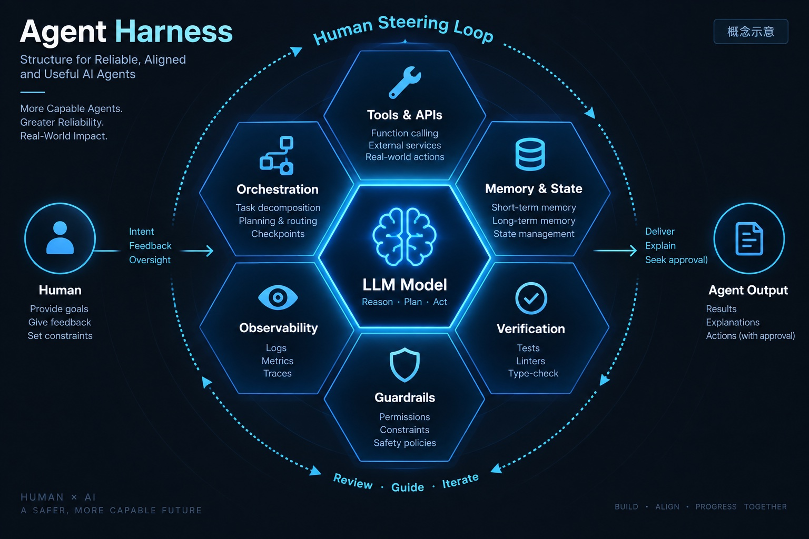
  <figcaption>Harness 核心组成 · AI 生成概念示意</figcaption>
</figure>

### 3.1 工具与 API 层（Tools & APIs）

工具是 Agent 与世界交互的唯一手段。Harness 的工具设计决定了 Agent 能做什么、以什么粒度操作。

<figure class="article-diagram">
  <a href="/assets/diagrams/articles/2026-04-10-harness-engineering-03.svg" target="_blank" rel="noopener" aria-label="打开原图：工具层架构：LLM → Tool Router → 分类执行">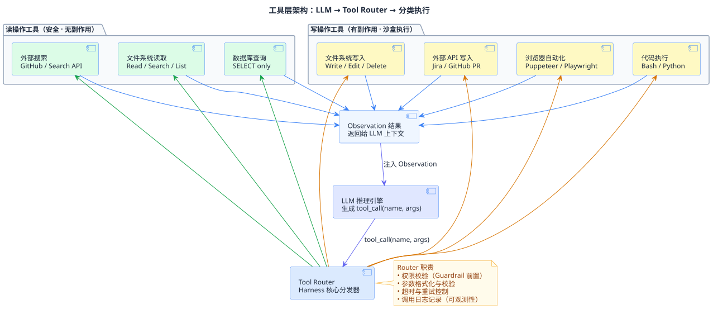</a>
  <figcaption>工具层架构：LLM → Tool Router → 分类执行 · <a href="/assets/diagrams/articles/2026-04-10-harness-engineering-03.svg" target="_blank" rel="noopener">查看原图</a> · <a href="/assets/diagrams/articles/2026-04-10-harness-engineering-03.puml" download>图表源文件</a></figcaption>
</figure>
**工具设计原则**：
- **最小权限**：Agent 只应拥有完成当前任务所需的最小工具集
- **可观测**：每次工具调用都应被记录，可回溯
- **幂等优先**：读操作优于写操作，写操作应有回滚机制
- **沙盒隔离**：危险操作（删除、部署）应在隔离环境中执行

### 3.2 记忆与状态管理（Memory & State）

LLM 本身无状态，Harness 负责构建和维护 Agent 的"记忆系统"：

<figure class="article-diagram">
  <a href="/assets/diagrams/articles/2026-04-10-harness-engineering-04.svg" target="_blank" rel="noopener" aria-label="打开原图：架构与交互图">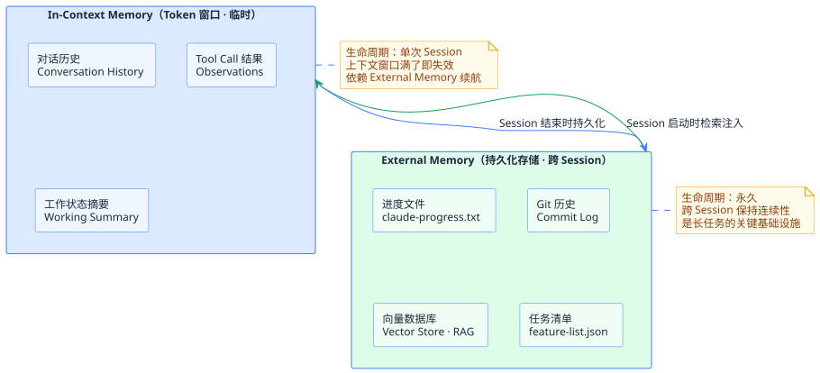</a>
  <figcaption>架构与交互图 · <a href="/assets/diagrams/articles/2026-04-10-harness-engineering-04.svg" target="_blank" rel="noopener">查看原图</a> · <a href="/assets/diagrams/articles/2026-04-10-harness-engineering-04.puml" download>图表源文件</a></figcaption>
</figure>
### 3.3 验证机制（Verification）

验证是 Harness 中最关键的反馈来源，分为两类：

| 类型 | 执行方式 | 速度 | 确定性 | 示例 |
|------|---------|------|--------|------|
| **Computational** | CPU，确定性 | 快（毫秒级） | 100% | 单元测试、Linter、类型检查、格式校验 |
| **Inferential** | GPU，LLM 推理 | 慢（秒级） | 非确定 | AI Code Review、语义正确性、架构合规 |

**核心原则：Keep Quality Left**

<figure class="article-diagram">
  <a href="/assets/diagrams/articles/2026-04-10-harness-engineering-05.svg" target="_blank" rel="noopener" aria-label="打开原图：Keep Quality Left：发现越早，修复成本越低">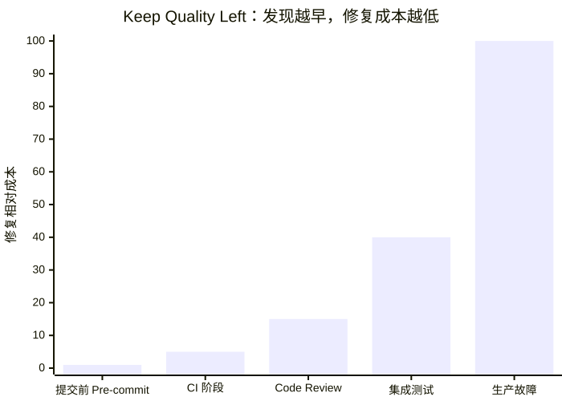</a>
  <figcaption>Keep Quality Left：发现越早，修复成本越低 · <a href="/assets/diagrams/articles/2026-04-10-harness-engineering-05.svg" target="_blank" rel="noopener">查看原图</a> · <a href="/assets/diagrams/articles/2026-04-10-harness-engineering-05.mmd" download>图表源文件</a></figcaption>
</figure>
越靠左（越早）发现问题，修复成本越低。Harness 的目标是把检测点尽量推到左侧。

### 3.4 护栏与权限（Guardrails）

护栏定义了 Agent **不能做**的边界，是 Harness 的安全层：

<figure class="article-diagram">
  <a href="/assets/diagrams/articles/2026-04-10-harness-engineering-06.svg" target="_blank" rel="noopener" aria-label="打开原图：Guardrail 状态机：Action 风险分级处理">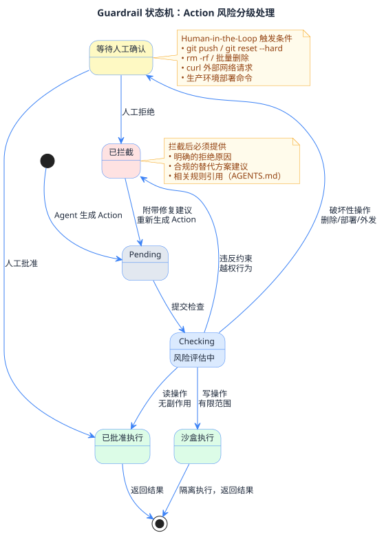</a>
  <figcaption>Guardrail 状态机：Action 风险分级处理 · <a href="/assets/diagrams/articles/2026-04-10-harness-engineering-06.svg" target="_blank" rel="noopener">查看原图</a> · <a href="/assets/diagrams/articles/2026-04-10-harness-engineering-06.puml" download>图表源文件</a></figcaption>
</figure>
### 3.5 可观测性（Observability）

> *"A one-off mistake is usually a context problem. Weeks of gradual degradation is a harness problem."*

没有可观测性，就无法区分这两种情况：

<figure class="article-diagram">
  <a href="/assets/diagrams/articles/2026-04-10-harness-engineering-07.svg" target="_blank" rel="noopener" aria-label="打开原图：架构与交互图">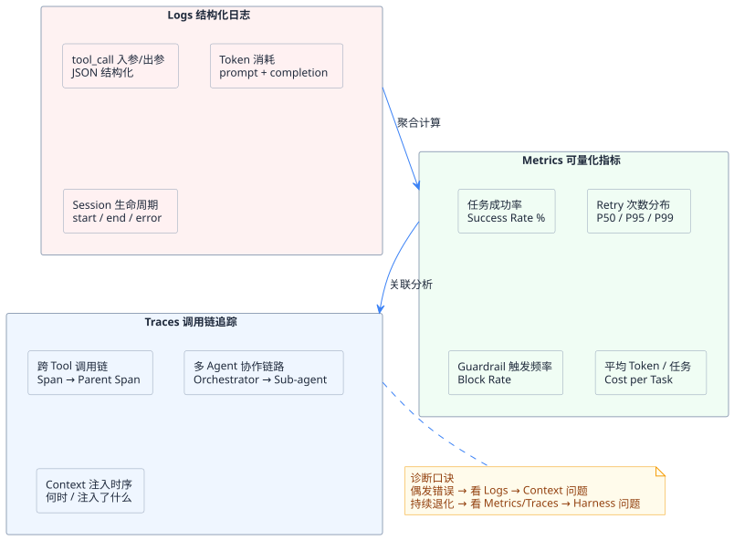</a>
  <figcaption>架构与交互图 · <a href="/assets/diagrams/articles/2026-04-10-harness-engineering-07.svg" target="_blank" rel="noopener">查看原图</a> · <a href="/assets/diagrams/articles/2026-04-10-harness-engineering-07.puml" download>图表源文件</a></figcaption>
</figure>
---

## 4. 前馈与反馈：控制系统视角

Martin Fowler 借用**控制系统**的概念来描述 Harness 的两种工作方式，这是 Harness Engineering 最核心的思维模型。

<figure>
  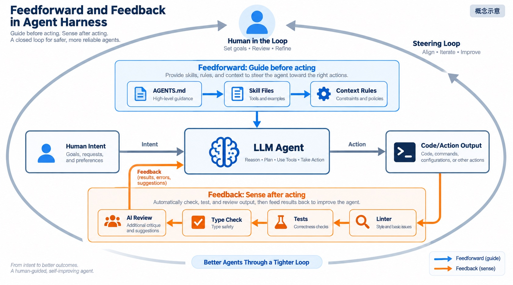
  <figcaption>前馈与反馈 · AI 生成概念示意</figcaption>
</figure>

### 4.1 前馈（Feedforward）：行动前引导

前馈机制在 Agent **行动之前**注入信息，预防问题发生，提高首次正确率。

<figure class="article-diagram">
  <a href="/assets/diagrams/articles/2026-04-10-harness-engineering-08.svg" target="_blank" rel="noopener" aria-label="打开原图：前馈机制：Context 注入组件视图">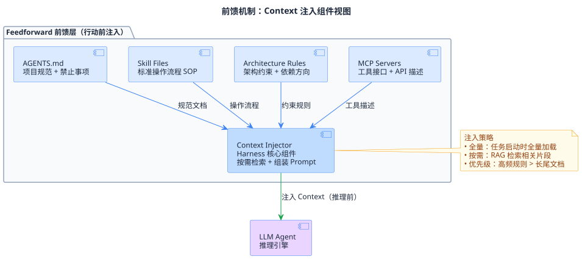</a>
  <figcaption>前馈机制：Context 注入组件视图 · <a href="/assets/diagrams/articles/2026-04-10-harness-engineering-08.svg" target="_blank" rel="noopener">查看原图</a> · <a href="/assets/diagrams/articles/2026-04-10-harness-engineering-08.puml" download>图表源文件</a></figcaption>
</figure>
**AGENTS.md 典型内容结构**：

```markdown
# AGENTS.md

## 项目概述
这是一个 Java Spring Boot 微服务，使用 PostgreSQL...

## 代码规范
- 所有公共 API 必须有 Javadoc
- 禁止直接使用 System.out，统一用 SLF4J
- 单元测试覆盖率不低于 80%

## 架构约束
- 禁止在 Controller 层直接调用 Repository
- 跨服务调用只能通过 FeignClient

## 技术栈
- JDK 17, Spring Boot 3.2, Maven
- 运行测试: mvn test
- 启动服务: mvn spring-boot:run -Dport=8080

## 当前已知问题
- Issue #234: 支付模块有内存泄漏，暂勿修改 PaymentService.java
```

### 4.2 反馈（Feedback）：行动后感知

反馈机制在 Agent **行动之后**检测结果，提供自纠正信号。

<figure class="article-diagram">
  <a href="/assets/diagrams/articles/2026-04-10-harness-engineering-09.svg" target="_blank" rel="noopener" aria-label="打开原图：反馈机制：Agent 行动后的验证时序">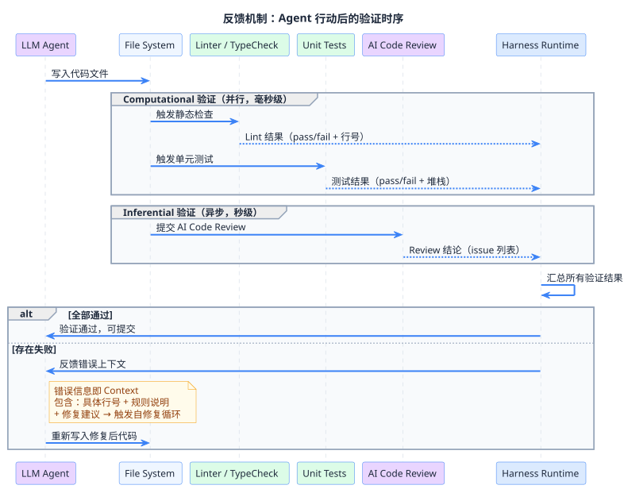</a>
  <figcaption>反馈机制：Agent 行动后的验证时序 · <a href="/assets/diagrams/articles/2026-04-10-harness-engineering-09.svg" target="_blank" rel="noopener">查看原图</a> · <a href="/assets/diagrams/articles/2026-04-10-harness-engineering-09.puml" download>图表源文件</a></figcaption>
</figure>
### 4.3 Steering Loop：人机协作的持续改进

Harness 不是一次性配置，而是一个**持续演进的系统**。人类通过观察 Agent 的失败模式，不断改进前馈和反馈机制：

<figure class="article-diagram">
  <a href="/assets/diagrams/articles/2026-04-10-harness-engineering-10.svg" target="_blank" rel="noopener" aria-label="打开原图：Harness Steering Loop（持续改进循环）">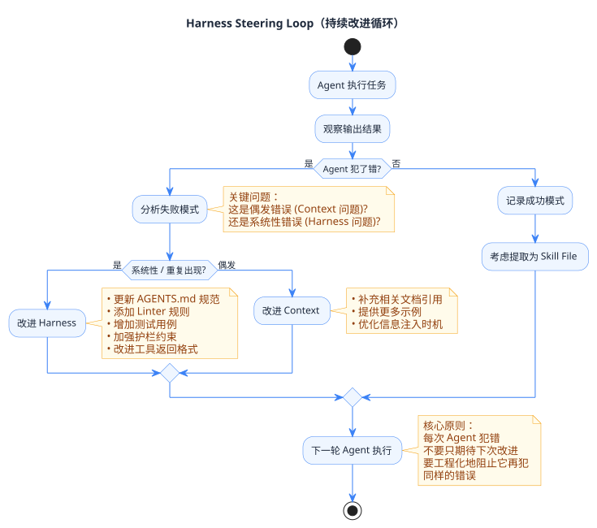</a>
  <figcaption>Harness Steering Loop（持续改进循环） · <a href="/assets/diagrams/articles/2026-04-10-harness-engineering-10.svg" target="_blank" rel="noopener">查看原图</a> · <a href="/assets/diagrams/articles/2026-04-10-harness-engineering-10.puml" download>图表源文件</a></figcaption>
</figure>
---

## 5. Harness 设计模式

基于 arXiv 2026 年学术综述（*Natural-Language Agent Harnesses*）和业界实践，现代 Agent Harness 有七种核心设计模式：

<figure class="article-diagram">
  <a href="/assets/diagrams/articles/2026-04-10-harness-engineering-11.svg" target="_blank" rel="noopener" aria-label="打开原图：流程与关系图"></a>
  <figcaption>流程与关系图 · <a href="/assets/diagrams/articles/2026-04-10-harness-engineering-11.svg" target="_blank" rel="noopener">查看原图</a> · <a href="/assets/diagrams/articles/2026-04-10-harness-engineering-11.mmd" download>图表源文件</a></figcaption>
</figure>
### 5.1 Reason-Act Loop（ReAct 模式）

最基础也最重要的模式，LLM 交替执行推理和工具调用：

<figure class="article-diagram">
  <a href="/assets/diagrams/articles/2026-04-10-harness-engineering-12.svg" target="_blank" rel="noopener" aria-label="打开原图：ReAct Loop：推理-行动循环">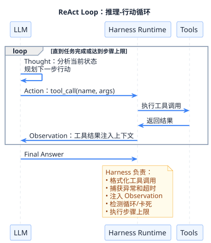</a>
  <figcaption>ReAct Loop：推理-行动循环 · <a href="/assets/diagrams/articles/2026-04-10-harness-engineering-12.svg" target="_blank" rel="noopener">查看原图</a> · <a href="/assets/diagrams/articles/2026-04-10-harness-engineering-12.puml" download>图表源文件</a></figcaption>
</figure>
### 5.2 Verification Gate（验证门控）

在 Agent 行动前后插入强制检验点，防止错误向下传播：

<figure class="article-diagram">
  <a href="/assets/diagrams/articles/2026-04-10-harness-engineering-13.svg" target="_blank" rel="noopener" aria-label="打开原图：流程与关系图"></a>
  <figcaption>流程与关系图 · <a href="/assets/diagrams/articles/2026-04-10-harness-engineering-13.svg" target="_blank" rel="noopener">查看原图</a> · <a href="/assets/diagrams/articles/2026-04-10-harness-engineering-13.mmd" download>图表源文件</a></figcaption>
</figure>
### 5.3 Multi-Agent Orchestration（多 Agent 编排）

<figure class="article-diagram">
  <a href="/assets/diagrams/articles/2026-04-10-harness-engineering-14.svg" target="_blank" rel="noopener" aria-label="打开原图：多 Agent 编排模式">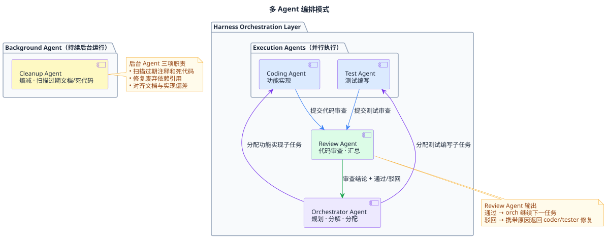</a>
  <figcaption>多 Agent 编排模式 · <a href="/assets/diagrams/articles/2026-04-10-harness-engineering-14.svg" target="_blank" rel="noopener">查看原图</a> · <a href="/assets/diagrams/articles/2026-04-10-harness-engineering-14.puml" download>图表源文件</a></figcaption>
</figure>
### 5.4 Long-Running Harness（长任务双层架构）

Anthropic 2025 年提出，专门解决跨 Context Window 的任务持续性问题（详见第 8 章）。

---

## 6. 生产实践：真实案例解析

### 6.1 OpenAI：用 Codex 构建内部工具（2026.02）

OpenAI 工程团队发布报告，描述了他们如何用 Codex 在 **约 1/10 的时间**内完成原本需要手写的代码量。

**Harness 核心设计**：

| 组件 | 实现方式 |
|------|---------|
| **Chrome DevTools 集成** | Agent 可直接看到 UI 并复现 bug，无需截图描述 |
| **隔离可观测栈** | 每个任务独立的 logs/metrics/traces，便于 Agent 理解状态 |
| **可衡量的约束** | "启动需在 800ms 内完成"变为可验证的指标，而非模糊描述 |
| **架构规则机械化** | 依赖方向检查自动化，违规在合并前被拦截 |
| **教学式 Linter** | 错误信息本身就是下次尝试的 Context，引导 Agent 自修复 |

> *"Humans steer. Agents execute."* — OpenAI Engineering Team

**角色转变**：

```
传统工程师：设计 → 编码 → 测试 → 调试
AI 时代工程师：设计系统 → 构建 Harness → 引导 Agent → 验证结果
```

### 6.2 Stripe：每周 1000+ AI 生成 PR

Stripe 的 Agent 系统被设计为处理**窄范围、定义清晰**的任务：

- 单元测试编写
- Linter 警告修复
- API 版本迁移
- 废弃依赖移除
- 文档更新

**核心 Harness 设计**：

<figure class="article-diagram">
  <a href="/assets/diagrams/articles/2026-04-10-harness-engineering-15.svg" target="_blank" rel="noopener" aria-label="打开原图：Stripe Agent Harness：任务全生命周期">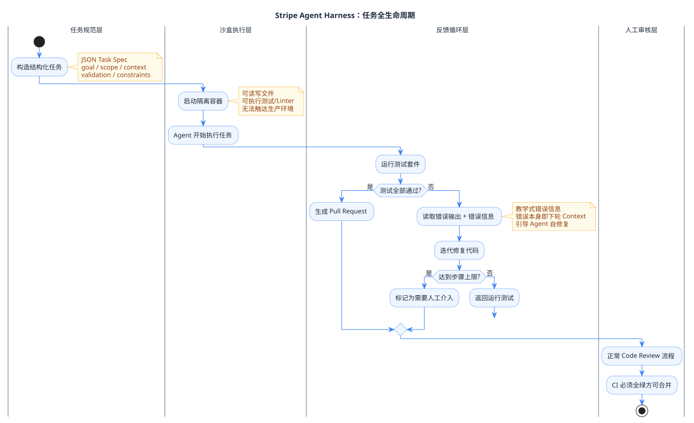</a>
  <figcaption>Stripe Agent Harness：任务全生命周期 · <a href="/assets/diagrams/articles/2026-04-10-harness-engineering-15.svg" target="_blank" rel="noopener">查看原图</a> · <a href="/assets/diagrams/articles/2026-04-10-harness-engineering-15.puml" download>图表源文件</a></figcaption>
</figure>
### 6.3 LangChain：Harness 改进驱动排行榜提升

LangChain 通过专注改进 Harness（而非更换模型），在 Terminal Bench 2.0 排行榜从 30 名外跃升至第 5 名。

**改进内容**：
- 更精确的工具调用格式定义
- 更丰富的错误处理反馈
- 改进的步骤追踪机制
- 更清晰的任务完成判断标准

这一案例清晰说明：**在当前阶段，模型已不是瓶颈，Harness 才是**。

---

## 7. Agent = Model + Harness：架构设计

### 7.1 完整架构图

<figure>
  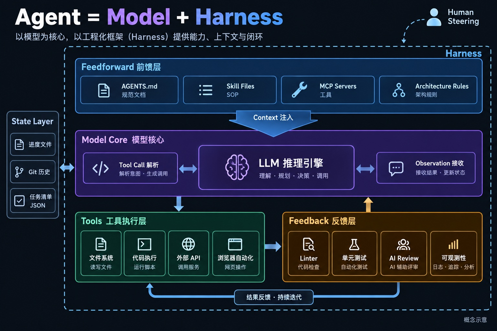
  <figcaption>Agent 完整架构 · AI 生成概念示意</figcaption>
</figure>

### 7.2 Harness 与 Framework 的区别

这是一个常见混淆点，Harrison Chase（LangChain 作者）给出了清晰区分：

| 维度 | Framework（如 LangChain） | Runtime | Harness |
|------|--------------------------|---------|---------|
| **是什么** | 构建 Agent 逻辑的积木 | Agent 执行的引擎 | Agent 生产运行的基础设施 |
| **关注点** | 开发体验、抽象层 | 调度、并发、生命周期 | 可靠性、约束、可观测性 |
| **换模型时** | 需要适配 | 需要适配 | **不需要改变**（模型无关） |
| **生产关键性** | 开发时重要 | 运行时重要 | **持续运营中最重要** |

---

## 8. 长任务 Agent：跨 Context Window 的挑战

### 8.1 核心问题

LLM 的上下文窗口是有限的。当任务需要跨越多个 Session（比如：实现一个包含 200+ 功能的完整应用），Agent 在每次新 Session 开始时都会"失忆"：

<figure class="article-diagram">
  <a href="/assets/diagrams/articles/2026-04-10-harness-engineering-16.svg" target="_blank" rel="noopener" aria-label="打开原图：流程与关系图">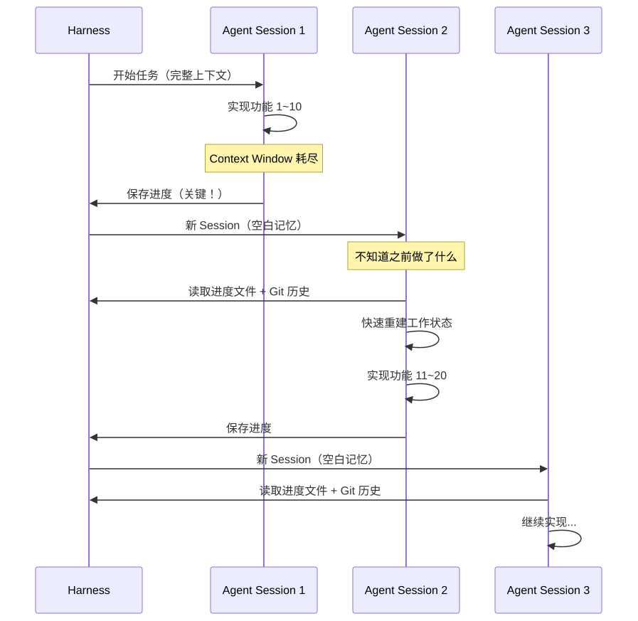</a>
  <figcaption>流程与关系图 · <a href="/assets/diagrams/articles/2026-04-10-harness-engineering-16.svg" target="_blank" rel="noopener">查看原图</a> · <a href="/assets/diagrams/articles/2026-04-10-harness-engineering-16.mmd" download>图表源文件</a></figcaption>
</figure>
### 8.2 Anthropic 的双层 Harness 方案

Anthropic 工程团队（2025.11）提出了专门针对长任务的 **双层 Harness 架构**：

<figure class="article-diagram">
  <a href="/assets/diagrams/articles/2026-04-10-harness-engineering-17.svg" target="_blank" rel="noopener" aria-label="打开原图：长任务双层 Harness 架构">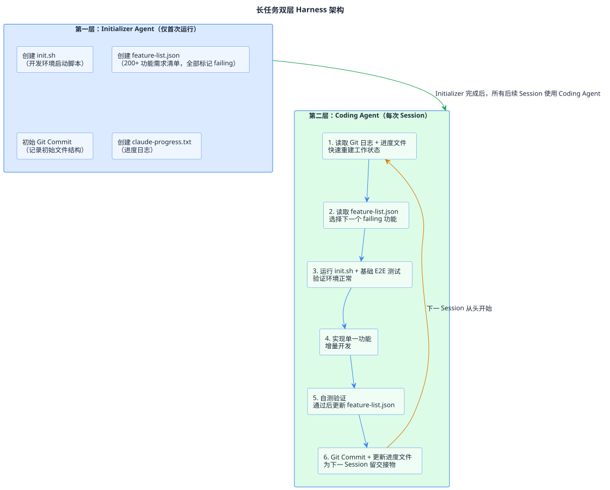</a>
  <figcaption>长任务双层 Harness 架构 · <a href="/assets/diagrams/articles/2026-04-10-harness-engineering-17.svg" target="_blank" rel="noopener">查看原图</a> · <a href="/assets/diagrams/articles/2026-04-10-harness-engineering-17.puml" download>图表源文件</a></figcaption>
</figure>
### 8.3 四大失败模式及对策

| 失败模式 | 根本原因 | Harness 对策 |
|---------|---------|-------------|
| **过早宣告完成** | 缺乏清晰完成标准 | Feature List 提供结构化验收标准 |
| **不知道环境状态** | 无交接机制 | Git 历史 + 进度文件 |
| **一次修改太多** | 缺乏范围约束 | 每次只做一个功能的 SOP |
| **测试不充分** | 反馈信号弱 | Puppeteer E2E 自动化测试 |

---

## 9. Harness Engineering vs Context Engineering

### 9.1 核心区别

> **Context Engineering** 解决的是 *Agent 知道什么*
>
> **Harness Engineering** 解决的是 *Agent 能做什么* 以及 *做错时会发生什么*

```
Context Engineering：  给 Agent 正确的地图
Harness Engineering：  确保 Agent 在正确的道路上行驶
```

| 维度 | Context Engineering | Harness Engineering |
|------|--------------------|--------------------|
| **关注点** | Token 窗口内的信息质量 | Agent 行动的约束与反馈系统 |
| **作用时机** | 推理时（in-context） | 推理前后（系统层面） |
| **解决的问题** | 模型不理解任务 | 模型理解但执行出错 |
| **典型手段** | RAG、Few-shot、文档注入 | CI、测试、护栏、监控 |
| **失效表现** | Agent 给出错误答案 | Agent 持续退化、系统性失败 |

### 9.2 一个诊断框架

当 Agent 出现问题时，如何判断是 Context 问题还是 Harness 问题？

<figure class="article-diagram">
  <a href="/assets/diagrams/articles/2026-04-10-harness-engineering-18.svg" target="_blank" rel="noopener" aria-label="打开原图：流程与关系图"></a>
  <figcaption>流程与关系图 · <a href="/assets/diagrams/articles/2026-04-10-harness-engineering-18.svg" target="_blank" rel="noopener">查看原图</a> · <a href="/assets/diagrams/articles/2026-04-10-harness-engineering-18.mmd" download>图表源文件</a></figcaption>
</figure>
---

## 10. 工程师的角色转变

Harness Engineering 带来的不仅是技术方法论的变化，更是研发工程师**职能定位**的根本性转变。

<figure>
  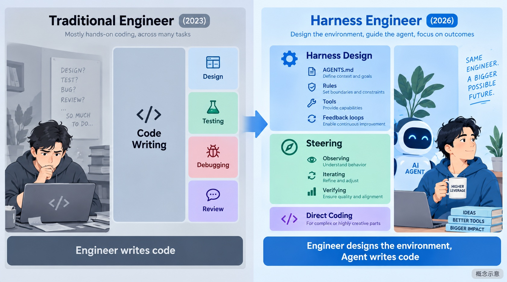
  <figcaption>工程师角色变化 · AI 生成概念示意</figcaption>
</figure>

### 10.1 职能变化对比

| 职能维度 | 传统工程师 | Harness 工程师 |
|---------|-----------|--------------|
| **主要产出** | 代码 | Harness 系统（规范、工具、测试、反馈） |
| **核心技能** | 编程、算法 | 系统设计、反馈工程、可观测性 |
| **调试对象** | 代码逻辑 | Agent 行为模式 |
| **质量保证** | 手写测试 | 设计 Agent 无法绕过的验证门 |
| **文档工作** | 事后补文档 | AGENTS.md 是第一优先级 |
| **迭代节奏** | PR → Review → Merge | 观察失败 → 改进 Harness → 重跑 |

### 10.2 新的核心能力栈

<figure class="article-diagram">
  <a href="/assets/diagrams/articles/2026-04-10-harness-engineering-19.svg" target="_blank" rel="noopener" aria-label="打开原图：流程与关系图"></a>
  <figcaption>流程与关系图 · <a href="/assets/diagrams/articles/2026-04-10-harness-engineering-19.svg" target="_blank" rel="noopener">查看原图</a> · <a href="/assets/diagrams/articles/2026-04-10-harness-engineering-19.mmd" download>图表源文件</a></figcaption>
</figure>
---

## 11. 落地路线图

### 11.1 成熟度模型

<figure class="article-diagram">
  <a href="/assets/diagrams/articles/2026-04-10-harness-engineering-20.svg" target="_blank" rel="noopener" aria-label="打开原图：Harness Engineering 团队成熟度路线图">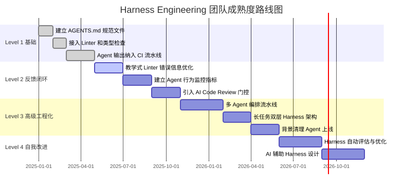</a>
  <figcaption>Harness Engineering 团队成熟度路线图 · <a href="/assets/diagrams/articles/2026-04-10-harness-engineering-20.svg" target="_blank" rel="noopener">查看原图</a> · <a href="/assets/diagrams/articles/2026-04-10-harness-engineering-20.mmd" download>图表源文件</a></figcaption>
</figure>
### 11.2 从零开始的第一步

```
第 1 周：建立 AGENTS.md
├── 项目概述（技术栈、架构）
├── 代码规范（命名、注释、结构）
├── 禁止事项（已知风险区域）
└── 运行方式（测试、启动命令）

第 2 周：加强验证反馈
├── 确保 Linter 错误信息清晰可读
├── 测试失败信息包含修复建议
└── 将验证步骤加入 Agent 的 SOP

第 3 周：建立可观测性
├── 记录 Agent 每次 Tool Call
├── 统计成功率和 Retry 次数
└── 识别最高频的失败模式

第 4 周：针对性改进 Harness
└── 将最高频失败模式转化为机械化约束
```

### 11.3 核心 Harness 文件结构

```
project/
├── AGENTS.md                    # 主要规范文档（必须）
├── .cursor/rules/               # Cursor 规则文件
│   ├── code-style.mdc
│   └── architecture.mdc
├── scripts/
│   ├── agent-init.sh            # Agent 环境初始化
│   └── agent-validate.sh        # Agent 输出验证
├── harness/
│   ├── skills/                  # Skill Files（标准操作流程）
│   │   ├── add-api-endpoint.md
│   │   └── write-unit-test.md
│   ├── feature-list.json        # 长任务功能清单
│   └── progress.md              # 跨 Session 进度日志
└── .github/
    └── workflows/
        └── agent-ci.yml         # Agent 输出的专用 CI
```

---

## 12. 当前局限与未来方向

### 12.1 当前局限

| 局限 | 描述 | 缓解方式 |
|------|------|---------|
| **Inferential 验证成本高** | AI Code Review 慢且贵，不适合每次提交 | 分层验证，关键路径才用 Inferential |
| **Harness 维护成本** | AGENTS.md 等文件会过期 | 背景 Agent 持续扫描更新 |
| **跨语言/项目迁移性差** | 针对具体项目的 Harness 难以复用 | 标准化 Harness 接口规范（NLAH 方向） |
| **多 Agent 协调复杂** | Agent 间通信、状态共享有挑战 | 标准化 Agent 间协议 |
| **Guardrail 和能力的平衡** | 过严的护栏限制 Agent 解决创造性问题 | 分层权限 + 人工审批升级 |

### 12.2 未来方向

<figure class="article-diagram">
  <a href="/assets/diagrams/articles/2026-04-10-harness-engineering-21.svg" target="_blank" rel="noopener" aria-label="打开原图：Harness Engineering 演进路线">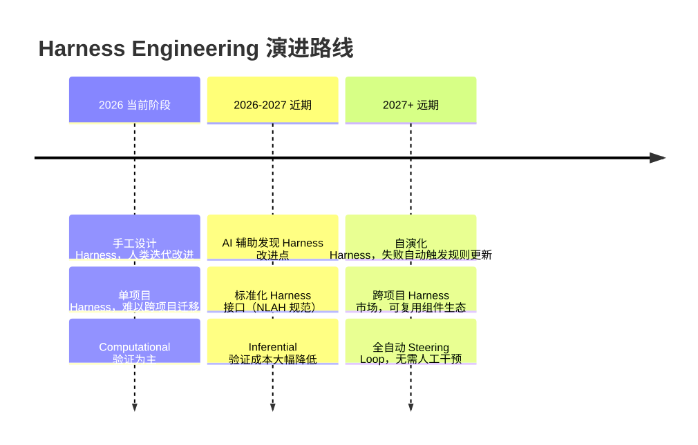</a>
  <figcaption>Harness Engineering 演进路线 · <a href="/assets/diagrams/articles/2026-04-10-harness-engineering-21.svg" target="_blank" rel="noopener">查看原图</a> · <a href="/assets/diagrams/articles/2026-04-10-harness-engineering-21.mmd" download>图表源文件</a></figcaption>
</figure>
### 12.3 一个核心信念

> *"Every time an agent makes a mistake, don't just hope it does better next time. Engineer the environment so it cannot make that specific mistake the same way again."*
>
> — Louis Bouchard, *Harness Engineering: The Missing Layer Behind AI Agents*（2026.03）

这句话是 Harness Engineering 的精髓：从**期待模型更好**，转变为**工程化地消除错误**。这才是系统性可靠性的来源。

---

## 附录

### A. 关键资源

| 资源 | 链接 | 类型 |
|------|------|------|
| Martin Fowler：Harness Engineering 权威定义 | https://martinfowler.com/articles/harness-engineering.html | 文章 |
| Anthropic：长任务 Harness 实践 | https://www.anthropic.com/engineering/effective-harnesses-for-long-running-agents | 工程博客 |
| OpenAI：Codex Harness Engineering | https://openai.com/index/harness-engineering/ | 工程博客 |
| arXiv：Natural-Language Agent Harnesses | https://arxiv.org/html/2603.25723v1 | 学术论文 |
| Salesforce：Agent Harness 定义 | https://www.salesforce.com/agentforce/ai-agents/agent-harness/ | 文章 |
| Claude Code：How It Works | https://code.claude.com/docs/en/how-claude-code-works | 文档 |

### B. 核心术语表

| 术语 | 定义 |
|------|------|
| **Harness** | Agent 中除 LLM 模型本身之外的所有基础设施 |
| **Feedforward** | 行动前注入的引导信息（AGENTS.md、Skill Files 等） |
| **Feedback / Sensor** | 行动后的检验机制（测试、Linter、AI Review） |
| **Computational Verification** | 确定性、快速的 CPU 验证（测试、静态分析） |
| **Inferential Verification** | 语义性、基于 LLM 的验证（AI Code Review） |
| **Steering Loop** | 人类观察 Agent 失败并迭代改进 Harness 的循环 |
| **AGENTS.md** | 项目的主要规范文档，Agent 每次启动时读取 |
| **Skill File** | 标准化操作流程文档，描述如何完成特定任务 |
| **Guardrail** | 限制 Agent 行动范围的约束机制 |
| **HITL** | Human-in-the-Loop，高风险操作需人工确认 |
| **Context Rot** | 长任务中上下文信息质量随时间退化的现象 |
| **NLAH** | Natural-Language Agent Harness，用自然语言描述的可移植 Harness |

---

> **免责声明**：本文基于 2025-2026 年公开资料整理，Harness Engineering 作为新兴概念仍在快速演进，部分定义和实践尚未形成业界共识。

*最后更新：2026 年 4 月 | 面向研发工程师的 AI 工程实践*
