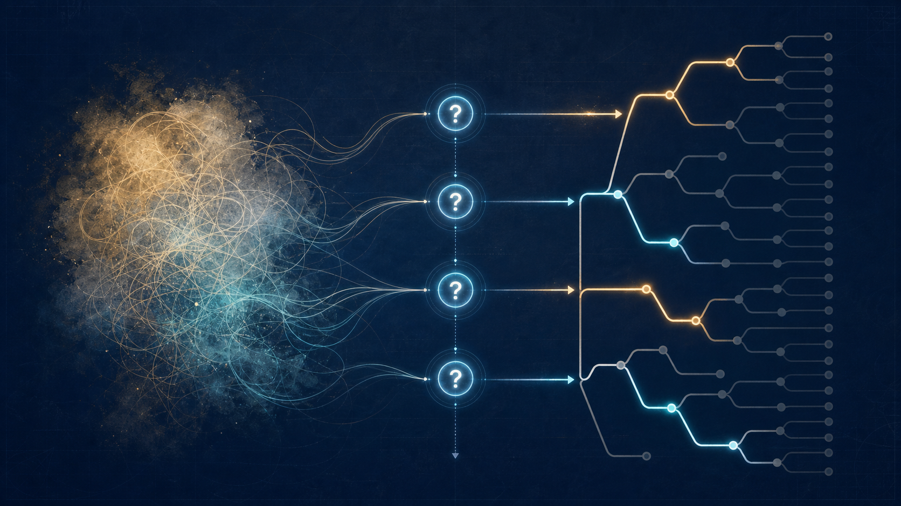

# 最好的 Skill，可能是逼你重新思考

**副标题：从热门 Skill `grill-me` 看 AI 如何从答案机器变成认知对手**


---

## 作者按

我们正在把 AI 训练成一种极其顺从的东西。

你提出一个模糊需求，它最好立刻理解；你只说一句“帮我设计一下”，它最好马上给出完整方案；如果它连续追问几个问题，我们甚至会觉得这个模型“不够智能”。

于是，AI 越来越擅长在目标尚未被想清楚之前，迅速给出一条看起来可以执行的路径。

这当然提高了效率。

但有时，它只是让我们更快地做了一件并不应该做的事。

最近，一个叫作 [`grill-me`](https://skills.sh/mattpocock/skills/grill-me) 的 Agent Skill 引起了我的注意。截至 2026 年 7 月 16 日，它在 Skills.sh 上已有 **565,990 次安装**；它所在的 [`mattpocock/skills`](https://github.com/mattpocock/skills) 仓库，也积累了约 **17.3 万个 Star**。

它做的事情和大多数 AI 工具正好相反：

> 它不急着回答你，而是开始审问你。

这篇文章想讨论的，不只是一个热门 Skill。

它想讨论一个更重要的问题：

> 如果 AI 最有价值的能力不是替我们回答问题，而是阻止我们过早得到答案呢？

---

## 一、我们把 AI 变成了一台答案机器

今天，人们判断一个 AI 好不好，常用的标准是：

- 能不能一次理解需求；
- 能不能减少沟通轮次；
- 能不能直接给出完整结果；
- 能不能不要反复确认；
- 能不能从一句话自动补全所有上下文。

这些标准都指向同一个方向：**消除阻力。**

过去需要开会讨论半天的事情，现在希望一句提示词解决；过去需要几轮需求澄清，现在希望 AI 自动猜中；过去需要人在多个方案之间做判断，现在希望模型直接告诉我们“最佳实践”。

AI 也确实越来越会猜。

你说：“我要做一个面向程序员的知识库产品。”

一个典型的 AI 很可能马上回答：

> 建议采用 Next.js、PostgreSQL 和向量数据库，支持 Markdown 导入、语义搜索、团队空间、权限管理和 AI 问答。下面是 MVP 功能列表和四周开发计划……

这个答案可能专业、完整，甚至可以直接开工。

但它跳过了几个更根本的问题：

- “程序员”是独立开发者，还是企业研发团队？
- 他们缺的是搜索工具，还是知识整理机制？
- 知识从哪里产生，又为什么没有被保存下来？
- 这个产品解决的是“找不到”，还是“根本没人愿意写”？
- 用户今天用什么替代方案？
- 如果只能验证一个假设，应该验证哪一个？
- 什么结果能够证明这个产品不值得继续做？

AI 给出的方案越完整，人越容易忘记：**完整不等于正确，能够执行也不等于值得执行。**

当一个模糊念头被迅速包装成技术架构、功能列表和时间表，它便获得了一种虚假的确定性。

看起来，问题已经被解决。

实际上，问题还没有真正出现。

---

## 二、一个故意让 AI 变慢的 Skill

`grill-me` 的设计非常简单。

它要求 Agent 对一个计划、设计或决定展开持续追问，沿着决策树逐个处理问题，直到双方形成共同理解。

它有几条很有意思的规则：

**第一，一次只能问一个问题。**

它不会一次扔出十几个澄清问题，让人面对一张新的待办清单。它提出一个问题，等待回答，再根据回答决定下一个问题。

**第二，先解决父决策，再进入子决策。**

如果“为谁服务”还没有确定，就不急着讨论功能；如果成功标准还不清楚，就不急着安排开发周期。

**第三，每个问题都要附带 AI 自己的推荐答案。**

用户不是面对空白问题凭空作答，而是可以同意、反对或修改一个具体建议。

**第四，能够从环境里找到的事实，AI 自己调查。**

代码库里已经写明的技术栈、现有接口和约束，不应该再由用户重复解释。事实由 AI 查，决定由人来做。

**第五，在双方确认形成共同理解之前，不采取行动。**

这可能是最反效率的一条规则。它主动阻止 AI 过早进入执行状态。

如果把普通 AI 的工作方式画成一条直线，大概是：

```text
收到需求 → 补全需求 → 生成方案 → 开始执行
```

`grill-me` 则把它改造成一棵树：

```text
收到想法
  ├─ 目标是谁？
  │   ├─ 个人用户
  │   └─ 企业团队
  ├─ 真正的问题是什么？
  │   ├─ 知识无法检索
  │   └─ 知识从未沉淀
  ├─ 如何证明有效？
  └─ 哪些事情明确不做？
```



它没有让 AI 变得更会回答。

它给 AI 加入了一种新的能力：**暂时拒绝回答。**

---

## 三、人并没有一个等待 AI 读取的完整需求

传统的人机交互隐含着一个假设：

> 人的脑中已经存在一个完整、稳定、清晰的意图，语言只是把它传递给机器时发生了损耗。

所以，我们总在追求“更懂用户”的 AI。

似乎只要模型足够聪明，它就能穿透含糊的表达，找到藏在人脑深处的真实需求。

但现实可能完全不同。

很多时候，人不是没有把需求表达清楚，而是**需求本身还没有形成**。

我们脑中拥有的，往往只是几种混杂在一起的东西：

- 一个模糊的不满；
- 对某个成功产品的模仿冲动；
- 对技术可能性的兴奋；
- 几个彼此冲突的目标；
- 一套尚未接受检验的因果解释；
- 以及一个事后听起来合理的故事。

一个创业者说“我要做 AI 知识库”，可能并不意味着他已经完成了选择，只是意味着他目前能为那种冲动找到的最好名字叫“AI 知识库”。

当 `grill-me` 继续追问：

> 如果不使用 AI，这个问题还存在吗？

> 用户为什么没有用现有工具解决？

> 你真正想验证的是搜索效果，还是用户愿不愿意持续沉淀知识？

这些问题不是在从人的脑中提取一个早已存在的答案。

答案是在被追问的过程中才逐渐形成的。

换句话说：

> **意图并不总是先于对话存在。很多意图，是对话的产物。**

这也是 `grill-me` 比“需求澄清工具”更值得讨论的地方。

它不是在帮助 AI 更准确地理解人。

它是在迫使人重新理解自己。

---

## 四、每一个问题，都是一次测量

这里可以借用一个“测量”的隐喻。

必须先强调：这是一种认识论类比，不是说人的意识真的遵循量子力学，也不是要用“量子坍缩”解释思维。

一个计划尚未被认真讨论时，很多可能性可以同时被保留。

我们既想快速上线，又想架构优雅；既想服务更多用户，又想保持产品简单；既不愿承担成本，又不愿放弃任何未来可能。

这些目标在语言里可以和平共处，因为它们还没有被放进同一个具体选择中。

问题的作用，是选择一个测量维度：

> 如果必须在两周上线和支持未来三年的扩展性之间选择，你选哪一个？

当人回答“两周上线”时，一部分原本模糊的可能性就被排除了。这个决定又会继续约束数据库选择、功能范围和测试投入。

于是，计划从一团可以容纳所有愿望的云雾，逐渐变成一条必须承担代价的路径。

但真正关键的地方不是“回答让选择变得确定”。

而是：

> **谁决定先问什么？**

如果 AI 先问“如何快速上线”，整个讨论会围绕速度展开；如果它先问“什么错误最不可接受”，讨论可能转向可靠性；如果它先问“谁会因为这个产品受损”，伦理与权力关系才会进入视野。

问题不是中性的容器。

一个问题会照亮某些东西，也会让另一些东西暂时留在黑暗里。

所以，当 AI 开始负责提问，它获得的不只是理解用户的能力。

它也获得了一部分**定义现实的权力**。

---

## 五、AI 是探测器、雕刻刀，也是引力场

在 `grill-me` 的交互里，AI 同时扮演着三种角色。

### 1. 探测器

它寻找计划中尚未暴露的空白。

目标和指标是否一致？技术方案是否偷偷假设了某种商业模式？所谓用户需求是否只是团队内部的想象？两个看似都正确的要求，是否在具体资源约束下互相冲突？

这时，AI 像一台探测器。

它没有替人选择，只是让原本不可见的问题显形。

### 2. 雕刻刀

模糊想法不会自动变成清晰方案。

每一次回答都切掉一部分可能性，让剩下的结构变得更明确。经过足够多的选择，“我想做一个知识库”才可能变成：

> 我们先服务 20—100 人的软件团队，解决故障复盘分散、历史决策难以检索的问题；第一阶段不做通用文档编辑器，只验证团队是否愿意通过对话查询已有决策记录。

这个方案不是从人脑中原样取出的。

它是被对话雕刻出来的。

### 3. 引力场

问题在于，雕刻刀有自己的方向。

`grill-me` 要求 AI 在每次提问时给出推荐答案。这确实降低了回答难度：相比“你想怎么做”，人更容易回应“我建议先做企业研发团队，你同意吗？”

但推荐答案也会成为一个锚点。

Tversky 与 Kahneman 在 1974 年关于不确定性判断的经典研究中，将“锚定与调整”描述为一种常见启发式：人会从一个初始参考点出发进行调整，而调整往往并不充分。后来的 AI 辅助决策实验也发现，AI 给出的建议会影响人的后续判断。

因此，“提供推荐答案”具有双重作用：

- 它帮助人摆脱空白页面；
- 它也让人的思考从 AI 选择的位置出发。

AI 不再只是探测你的想法，也不只是帮你塑造想法。

它还在用问题顺序、概念分类和默认答案，为你的思考建立一个引力场。


最终形成的方案，很难再说完全属于谁。

它不是人原本就拥有的计划，因为许多决定在对话之前根本不存在；它也不是 AI 独立生成的计划，因为每个关键分支仍由人确认。

它是一个在人与 AI 之间逐步形成的认知产物。

> **AI 没有简单地读懂人的意图。人与 AI 在对话中，共同制造了一个可以被双方理解的意图。**

---

## 六、我们需要的也许不是 AI 助手，而是 AI 对手

“AI 助手”这个词，天然带着一种服务关系。

助手接受目标、补充信息、提高效率，默认目标本身不需要被重新审查。

“AI 导师”更进一步。它拥有知识，能够指出明显错误，但它仍然倾向于把人带向某个它认为正确的答案。

`grill-me` 展示的是第三种关系：**AI 对手。**

这里的对手不是敌人。

它更像代码审查者、论文评审人、辩论中的反方，或者一个不愿意因为照顾气氛就假装听懂的同事。

它的职责不是让你舒服，而是：

- 攻击未经证明的假设；
- 要求模糊词语获得可检验的定义；
- 让相互冲突的目标正面相遇；
- 追问一个决定将排除什么；
- 阻止漂亮语言掩盖因果链条的断裂。

这种能力可以被称为**认知阻力**。

我们通常把阻力理解为低效：多一次确认、多一轮沟通、多一个不能立即执行的步骤。

但在复杂决策里，阻力并不总是浪费。

代码审查降低了提交速度，却减少了缺陷进入生产环境的概率；科学同行评议延迟了论文发表，却迫使结论接受他人的攻击；建筑设计中的安全规范增加了成本，却阻止局部效率成为系统性灾难。

有些阻力的价值，就在于让行动不能过早发生。

AI 时代真正稀缺的，可能不是更强的执行力。

执行力正在迅速变得廉价。一个未经检验的想法，现在可以比过去更快地变成代码、文案、产品和组织决策。

越是如此，我们越需要一种力量，在执行之前问：

> 你确定这是你真正想解决的问题吗？

---

## 七、但审问也可能成为另一种控制

把 AI 变成认知对手，并不意味着问题得到了解决。

相反，它带来了新的权力关系。

### 第一种风险：问题设定权

人只能回答被提出的问题。

如果 AI 的决策树只覆盖商业价值、技术成本和上线速度，那么没有进入决策树的劳动影响、隐私风险和长期依赖，就可能被误认为“不重要”。

真正危险的偏见，不一定表现为错误答案。

它可能表现为：**某些问题从未被问过。**

### 第二种风险：推荐答案的锚定

每个问题附带推荐答案，能够加快讨论，也可能让用户只是围绕 AI 的默认方案做局部修改。

表面上，人仍然拥有最终决定权。

实际上，选择空间已经被提前裁剪。

如果 AI 问“应该先做团队版还是个人版”，用户可能不会再追问：我们为什么一定要做一个新产品？是否应该先改变现有流程？真正的问题是否根本不需要软件解决？

### 第三种风险：伪共同理解

`grill-me` 的目标是形成 shared understanding，也就是共同理解。

但语言上的一致，并不意味着双方拥有相同的因果模型。

人和 AI 都可能使用“可靠性”“简单”“用户价值”这些词，却对它们意味着什么拥有完全不同的理解。双方越快达成流畅的语言共识，越可能忽略这种差异。

所以，一个真正好的追问型 AI，不仅应该允许人反对答案，还应该允许人反对问题：

- 为什么先问这个？
- 还有哪些完全不同的分析框架？
- 哪些分支被我们过早排除了？
- 如果站在受影响者而不是建设者的位置，会问什么？
- 如果你的推荐答案是错的，最可能错在哪里？

认知阻力不能只由 AI 施加给人。

人也必须保留向 AI 施加阻力的能力。

---

## 八、不要让 AI 过早地理解你

我们总希望 AI 更懂自己。

最好一句话就能理解意图，最好不必解释背景，最好在我们尚未说完时就猜到真正需求。

这种体验很迷人。

但 AI 时代最危险的时刻，可能正是一个系统过早地声称：

> 我明白你想要什么了。

然后，它以惊人的效率，把一个未经检验的愿望变成现实。

过去，模糊想法常常死于执行成本。团队、资金、时间和技术门槛，会迫使人反复解释自己的目标。

今天，AI 正在移除这些门槛。

这当然释放了创造力，也同时移除了许多原本被动存在的思考时间。

当执行越来越快，思考不能只追求同样的速度。

我们需要一些 Skill 帮助 AI 写得更好、画得更好、编码更快。我们也需要另一类 Skill，在所有事情开始之前，让 AI 暂时放下答案。

它不替你证明自己是对的。

它迫使你发现自己还没有想清楚。

> 如果一个 AI 只让你越来越轻松，它可能只是在放大你的惯性。
>
> 真正有价值的智能，有时应该让你停下来，让你感到不舒服，让你重新说明自己为什么要这样做。

最好的 Skill，不一定替你完成更多事情。

它可能只是让你在行动之前，第一次真正想清楚自己准备做什么。

---

## Skill 信息

- Skill：[`grill-me`](https://skills.sh/mattpocock/skills/grill-me)
- 源码：[`mattpocock/skills`](https://github.com/mattpocock/skills/tree/main/skills/productivity/grill-me)
- 安装命令：

```bash
npx skills add mattpocock/skills --skill=grill-me
```

## 参考资料

1. Amos Tversky、Daniel Kahneman，[*Judgment under Uncertainty: Heuristics and Biases*](https://pubmed.ncbi.nlm.nih.gov/17835457/)，*Science*，1974。
2. Lemuria Carter、Dapeng Liu，[*How was my performance? Exploring the role of anchoring bias in AI-assisted decision making*](https://doi.org/10.1016/j.ijinfomgt.2025.102875)，*International Journal of Information Management*，2025。
3. [`grill-me` Skill 源文件](https://github.com/mattpocock/skills/blob/main/skills/productivity/grill-me/SKILL.md)。
4. [`grilling` Skill 源文件](https://github.com/mattpocock/skills/blob/main/skills/productivity/grilling/SKILL.md)。
