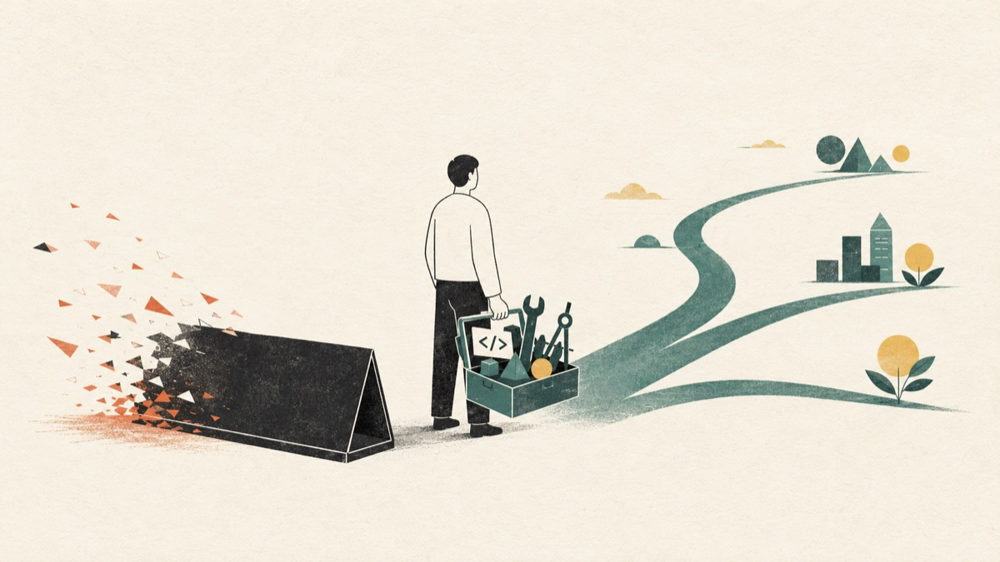
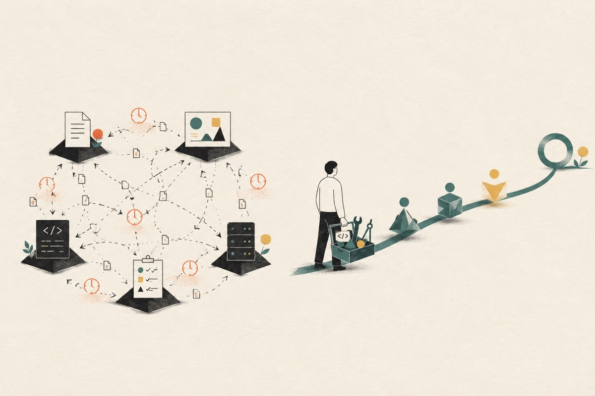
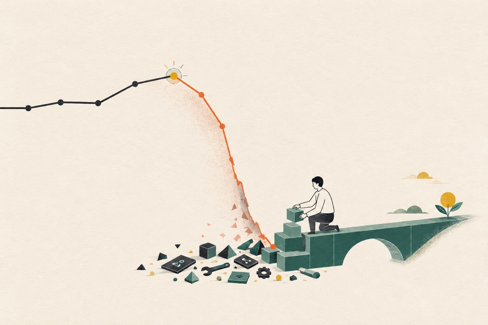
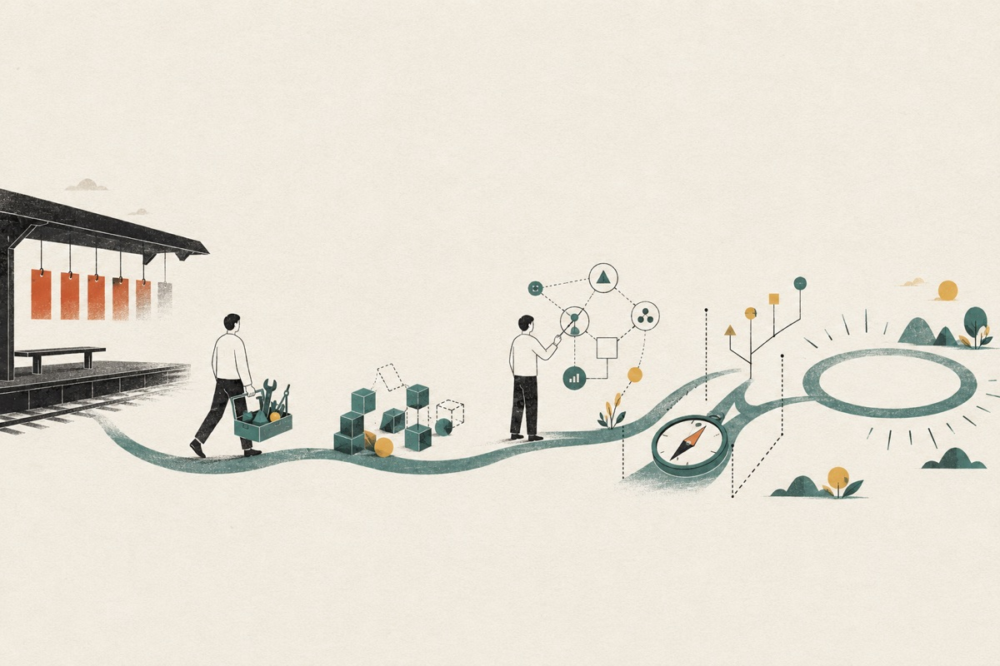

# 岗位消失了，人还在：AI 时代最残酷的价值重估

> AI 不需要替代每一个人。它只需要让一部分岗位失去单独存在的理由。

作者｜Dreaming




## 写在前面

我担心的不是某个模型又学会了什么，而是技术变化的速度，已经开始快过职业身份更新的速度。

一个人仍然拥有十年经验，甚至比昨天更熟练，但市场已经不再购买他所熟练的那一整包东西。

消失的不是人，也不一定是能力。

消失的是能力原来的计价单位。

---

2026 年 7 月，微软宣布削减 4800 个岗位。公司强调这些岗位“不是被 AI 取代”，但紧接着又承认：AI 正在改变工作的完成方式，部分日常任务已经可以自动化，工程团队的结构也将随之变化。

Meta 在扩大 AI 投入的同时裁减约 8000 人，并留下约 6000 个空缺岗位不再招聘；Amazon 连续两轮削减约 3 万个企业岗位，反复强调减少层级、增加责任。

中国公司的公开裁员数字没有那么集中，但组织也在重新布线：阿里把多个核心 AI 团队收拢到 CEO 直接负责的新组织；腾讯撤销运行近十年的 AI Lab，将部分人员并入混元。

这些动作形式不同，却指向同一个方向：

> 公司不再只是给旧组织添加一个 AI 工具，而是在按照 AI 的能力重新划分权力、预算和岗位。

## 一、AI 最先消灭的，可能是交接

裁员不只有 AI 一个原因。过度招聘、增长放缓、管理层膨胀、资本开支上升，都在影响人员调整。

但 AI 确实改变了组织的计算方式。

过去，一个功能需要产品写需求、设计出稿、开发分层实现、测试验收、运维部署。现在，一个人带着一组 Agent，已经可以跨过其中好几道边界。

组织里最昂贵的，往往不是某个动作本身，而是动作之间的等待、沟通、排期、验收和责任分割。

所以，AI 最先消灭的可能不是代码、设计稿或测试用例。

它最先消灭的是交接。

当交接减少，建立在交接之上的岗位边界，就会跟着变薄。




## 二、不要急着制作一张“岗位死亡名单”

讨论 AI 时，人们总想知道下一个消失的是前端、测试、客服、设计，还是运营。只要点出一个名字，焦虑就有了具体对象。

前端开发确实是 AI Coding 高度暴露的样本之一：代码结构化程度高，结果可以直接在浏览器验证，页面、接口、测试和部署之间的边界也正在被 Agent 打通。

2025 年 Stack Overflow 调查中，全栈开发者占 27%，纯前端开发者占 4.3%。它不能证明前端必然消失，却说明职业标签正在向端到端责任倾斜。

但把问题写成“前端要消失了”，会错过真正的规律：

> 任何主要价值来自“完成流水线中的固定一段”，而不是“对最终结果负责”的岗位，边界都可能被 AI 压缩。

前端不会消失，用户界面、交互、性能和设计系统也不会消失。可能消失的，是公司为“只交付其中一层”长期设置大量独立职位的必要性。

今天被重新打包的是前端与后端，明天可能是测试与开发、产品与运营、分析与决策。

这不是某一个职业的问题，而是所有依赖稳定分工的人共同面对的问题。

## 三、岗位消失了，为什么收入会从 100 万变成 0？

假设世界上有 1000 万人，都以某个岗位作为职业身份。有人年薪 20 万，有人 50 万，有人 100 万。

某一天，公司不再招聘这个岗位了。

公司并不是不需要原来的工作，只是把工作拆散，交给 AI，或者重新组合进另一个更大的岗位。

那么，一个昨天年薪 100 万的人，今天值多少？

如果他坚持只出售已经没人单独采购的“岗位包”，报价真的可能接近 0。

> 技术带来的收入变化，不一定是一条缓慢下降的曲线。岗位一旦失去独立存在的理由，价格可能出现断崖。

市场不按照你为一项技能投入了多少青春来定价。它只看今天还有多少人愿意为这项能力单独付费。

```text
市场价值 ≈ 可负责结果 × 稀缺性 × 可信度
```

会某个框架、熟悉某套流程，描述的是技能库存；能把一个模糊问题变成可靠结果，描述的才是可负责结果。

当 AI 让大量技能库存变得便宜，后者就会成为新的计价单位。




## 四、真正归零的不是人，而是旧的交易方式

岗位不是人的本体。

岗位只是某个历史阶段，企业为了降低协作成本，把一组任务打包之后起的名字。当技术改变协作成本，任务会重新打包，名字也会消失。

一个人真正拥有的资产，不只是岗位说明书上的动词，而是更底层的能力：理解问题、建立系统、判断质量、做出取舍、承担责任，以及借助新工具扩大自己的责任半径。

具体工具会过时，岗位名称会变化，但这些能力可以迁移到下一个尚未命名的职业中。

人的价值没有归零。

归零的是他坚持使用旧包装出售自己的那种方式。

## 五、人还在，接下来怎么办？

最差的策略，是继续把全部时间投入到 AI 越来越擅长的工作里；第二差的策略，是慌乱学习所有技能，最后每一项都停留在“看过教程”。

真正需要改变的不是技能清单，而是责任边界。

### 从完成任务，转向负责结果

跨过相邻岗位的边界，理解上游为什么做、下游如何验证。你不必在每个领域都成为专家，但要能独立完成一段有真实价值的闭环。

### 把 AI 从工具升级为工作系统

真正稀缺的不是会向 AI 提问，而是能够定义任务、组织上下文、让 Agent 执行、验证结果，并在失败时恢复。

### 建立难以被生成的判断

技术越容易生成，领域知识、约束理解、审美、责任和取舍能力就越值钱。不要只知道如何实现，还要知道什么值得做、什么不能做。

可以给自己 90 天：

1. **前 30 天**：让 AI 重做你的常规工作，识别哪些能力已经商品化；
2. **第 31～60 天**：跨越至少一个旧岗位边界，独立交付完整结果；
3. **第 61～90 天**：进入一个具体领域，用真实反馈迭代并公开复盘。

目标不是急着换一个更安全的新标签，而是不再依赖任何一个标签才能证明自己的价值。




## 结语：当岗位消失之后

不要再执着于预测，下一个被 AI 替代的究竟是谁。

任何具体答案，都会让一群人恐慌，让另一群人产生虚假的安全感。

更重要的问题是：

如果你的岗位明天不再招聘，你今天拥有的哪些能力，仍然可以被市场购买？

岗位会消失，人仍然存在。那些人的经验、责任、创造力和生活，不会随组织架构图一起消失。

但他们必须在旧计价方式失效之前，重新把自己组合成市场仍然需要的样子。

> 岗位是租来的，能力才是自己的；而能力也只有能够迁移，才真正属于你。

不要把未来几年用来证明 AI 做不到你今天的工作。

要用它们来证明：**即使 AI 能做到其中的大部分，你仍然能够借助它，负责更大的结果。**

---

## 参考资料

1. [Microsoft：The latest in our company transformation](https://blogs.microsoft.com/blog/2026/07/06/the-latest-in-our-company-transformation/)，2026-07-06。
2. [AP：Meta cuts 8,000 jobs as AI spending surges](https://apnews.com/article/microsoft-voluntary-buyouts-ai-224eee4489cbc227244558ff02f5919a)，2026-04-23。
3. [AP：Amazon cuts about 16,000 corporate jobs](https://apnews.com/article/amazon-layoffs-job-cuts-tech-74387fae2313ff7b0b1e638c00863443)，2026-01-28。
4. [Alibaba Cloud：Rebuilding Around AI](https://www.alibabacloud.com/en/press-room/alibaba-positions-for-accelerated-ai-growth-in-sec)，2026-06-30。
5. [财新：腾讯撤销 AI Lab，部分人员并入混元](https://www.caixin.com/2026-03-20/102425474.html)，2026-03-20。
6. [Stack Overflow Developer Survey 2025](https://survey.stackoverflow.co/2025/developers)。
